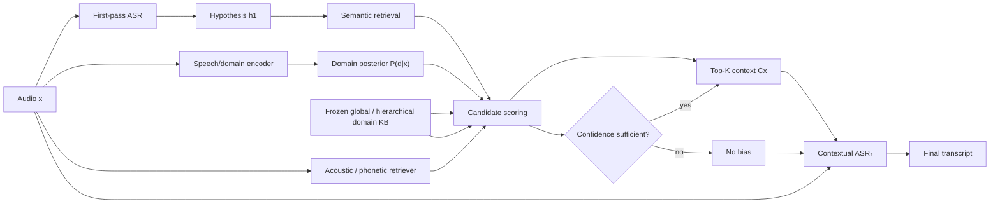

# Research Gap and Proposal Design for Contextual ASR Without Oracle Bias Lists

## Executive synthesis

The research target in your brief is more specific than “contextual ASR”: the system should **discover the context it needs at inference time rather than receiving an utterance-specific hotword list from the application**. The two settings are therefore (A) known domain plus audio, and (B) audio alone followed by automatic context discovery and contextual re-recognition. fileciteturn0file0

The central conclusion of this review is that **neither “automatic bias-term selection” nor “two-pass contextual ASR” is by itself a defensible novelty claim anymore**. Several recent systems already retrieve or filter a small bias set from a large candidate inventory using the current audio or a first-pass hypothesis. Huang et al. retrieve from as many as 100,000 phrases using utterance audio embeddings; BR-ASR scales speech-conditioned retrieval to 200,000 entries; RECAST retrieves textual keywords from ASR decoder states; Hou et al. rank a predefined large bias list against the utterance audio; and CTC-Assisted LLM-ASR explicitly performs coarse first-pass recognition, filters a predefined hotword list, and then performs contextual SpeechLLM recognition. citeturn26search1turn26search2turn26search0turn20view5turn20view0

More importantly, a 2025 Findings of EMNLP paper is literally titled **“Retrieval Augmented Generation based context discovery for ASR.”** It retrieves contextual words from a 466,358-word general vocabulary using embeddings of preceding ASR transcripts, evaluates an alternative in which an LLM generates context, and feeds the discovered context to contextual ASR. Its best retrieval configuration reduced WER relative to no context on TED-LIUM3, Earnings-21 and SPGISpeech, while being substantially cheaper than the LLM context generator. citeturn26search7turn28view0turn29view1 This paper is a major novelty threat and must be cited prominently in any proposal.

The 2026 Zhang et al. seed paper is also extremely close, but its actual boundary is favorable to the proposed project. Zhang et al. perform:

> **speech → intent/domain classification → domain-specific keyword prompt → ASR**

but explicitly state that **retrieving and filtering a manageable subset from a massive backend vocabulary is external application logic and outside the scope of their study**. Their contribution is chiefly intent-driven orchestration and MLLM prompt-based contextualization, not an utterance-conditioned retrieval algorithm over a large domain vocabulary. citeturn22search0turn19search0

Accordingly, the strongest remaining gap is narrower:

> **Given no utterance-specific bias list, can an ASR system use the audio, a noisy first-pass transcript, and uncertain/hierarchical domain evidence to retrieve a calibrated small top-\(K\) contextual vocabulary from a large domain-partitioned or global knowledge base, and then re-decode the original utterance without harming non-contextual words?**

The defensible novelty is therefore **not** “domain → keywords,” “audio → keyword retrieval,” “RAG for ASR,” or “two passes.” It is the combination of **uncertainty-aware domain conditioning, utterance-level hybrid acoustic/semantic retrieval, no oracle per-utterance candidate list, explicit robustness to domain error, and evaluation of domain granularity and soft-domain mixtures**. I found no primary work in the searched contextual-ASR literature that systematically studies the last three factors together. Zhang et al. use hard predicted intent; slot-triggered biasing uses learned domain/slot gating; the retrieval papers generally assume a candidate inventory but do not evaluate hierarchical domain granularity or propagate \(P(d\mid x)\) into vocabulary retrieval. citeturn22search0turn17search11turn26search1turn26search2turn26search0

My final recommendation is therefore a combination of **B + D + E + F** from your decision criterion:

**B. domain-conditioned contextual vocabulary retrieval**,  
**D. two-pass automatic context discovery**,  
**E. soft/hierarchical-domain contextual ASR**, and  
**F. an oracle-list-free benchmark protocol**.

LLM generation should be a baseline rather than the centerpiece. Existing direct evidence does not establish that it is superior to retrieval; in Siskos et al., embedding retrieval gave a better accuracy/latency trade-off than LLM context generation, while Zhang et al. themselves emphasize grounding the prompt in provided real entities rather than having the model hallucinate them. citeturn29view1turn28view0turn22search0

## The Zhang et al. seed paper and what it actually solves

Zhang, Zhang, Wang and Jang's **“Improving Contextual Biasing in Chinese ASR via Multimodal Large Language Models”** appeared in *IEEE Access* in February 2026. It uses CATSLU and a Phi-4-Multimodal-based architecture to connect direct speech intent recognition with keyword-prompted Mandarin ASR; the authors report a 41.48% relative KER reduction for their dynamic prompting method and 41.91% for their synthetic-data variant. citeturn19search0

The distinction that matters most for your proposal occurs in the paper's “Dynamic Prompt Generation” section. The authors say that a predicted broad intent such as music, navigation or video acts as a semantic filter; they motivate selecting a manageable subset such as frequently played songs or trending locations. But they then explicitly state that **the actual retrieval/filtering of that subset from a massive backend database is outside their primary scope**. Their experiments focus on injecting the resulting keywords into an MLLM. citeturn22search0

### Exact comparison against the twelve seed-paper questions

| Question | Evidence-based answer |
|---|---|
| **What is known at inference?** | The system receives the speech. In the mixed-domain setting the domain is not supplied; a speech-intent model predicts it. The system also assumes availability of domain-specific keyword resources from which prompts can be formed. In single-domain experiments the task/domain itself is known. citeturn19search0turn22search0 |
| **What is predicted?** | First, a broad intent/domain label is predicted directly from speech. The resulting domain controls contextual keyword prompting for a separate ASR task. citeturn19search0 |
| **Where do keyword lists come from?** | They are predefined domain resources derived from CATSLU/domain proper nouns; the synthetic-data pipeline likewise begins with a supplied domain-specific proper-noun list. citeturn19search0 |
| **Generated, retrieved, or statically mapped?** | The deployed experimental mechanism is best characterized as **domain/intent selection plus supplied keyword prompting**. The paper discusses choosing high-frequency/user-specific subsets, but explicitly leaves massive-backend retrieval/filtering to external application logic. Its LLM generation pipeline generates **training sentences around known terms**, not an open-world inference-time hotword list. citeturn22search0turn19search0 |
| **How large are candidate lists?** | The paper varies the number of prompt keywords and discusses large practical inventories, including an illustrative top-1,000-title scenario, but the accessible paper text does not expose one universal fixed candidate-list cardinality applicable to all three CATSLU domains. This value should therefore not be invented in a proposal; exact per-domain cardinalities should be taken from the authors' released preprocessing/code when reproducing the work. citeturn19search0 |
| **Is selection utterance-acoustic-dependent?** | Domain prediction is acoustic/semantic because it comes directly from the individual speech utterance. **Term-level ranking inside the selected domain vocabulary is not the main learned problem studied.** Their controlled ASR experiments randomly sample specified numbers of words from the domain list. citeturn19search0turn22search0 |
| **Is the same audio ASR-decoded twice?** | The audio is processed by two logical MLLM tasks: first speech-to-intent, then keyword-conditioned speech recognition. The first call is **not a first-pass transcript**, so this is not “ASR hypothesis → retrieve → re-decode same utterance” in the sense of Setting B. citeturn19search0 |
| **What if intent is wrong?** | The architecture implies that an incorrect intent routes the utterance to an inappropriate domain keyword resource, but the paper does not report the kind of conditional \( \text{WER}\mid d_{\text{correct}}\) versus \( \text{WER}\mid d_{\text{wrong}}\) robustness study required for your proposed research. The first statement is an architectural inference; the absence of such a reported analysis is what matters as a gap. citeturn19search0turn22search0 |
| **Distractors?** | Yes, to a degree. CATSLU domain lists contain terms that do not occur in a given utterance, and the keyword-count experiments randomly draw domain keywords so most true terms may be absent. The work therefore tests robustness to irrelevant same-domain terms, although it does not constitute a systematic wrong-domain/adversarial-distractor evaluation. citeturn19search0 |
| **Limitations/future work?** | The paper reports that excessively long prompts can cause a model such as Gemma 3n to lose focus on ASR and repeat prompt material; it notes that final performance remains bounded by the pretrained base model, and synthetic speech does not fully reproduce real sentence complexity. Most importantly for this proposal, scalable backend term retrieval is explicitly outside scope. citeturn19search0turn22search0 |
| **What does it already solve?** | It demonstrates **audio-only broad intent inference followed by intent-conditioned contextual ASR**, including a practical Mandarin/CATSLU implementation. Thus “predict domain from audio and use domain keywords” cannot be claimed as new. citeturn19search0 |
| **What remains open?** | Learned utterance-specific top-\(K\) retrieval from a very large \(V_d\); explicit acoustic + transcript-semantic + probabilistic-domain fusion; hierarchical domain granularity; hard versus soft domain conditioning; end-to-end analysis under domain-routing errors; and a benchmark where an oracle utterance-specific candidate list is never given. The first of these overlaps strongly with independent retrieval literature and must therefore be framed specifically around **domain uncertainty/open candidate construction**, not retrieval alone. citeturn22search0turn26search1turn26search2turn26search0 |

This sharply changes Gap G1. **“Domain → bias list → contextual ASR” is already partly solved.** A proposal that simply predicts music/weather/video and switches keyword dictionaries would be too close to Zhang et al. The publishable question begins where their paper explicitly stops: **how the small useful subset is discovered from a massive backend inventory, and what happens when the inferred domain is ambiguous or wrong.** citeturn22search0

## Evidence from the broader contextual-ASR literature

### Classical contextual biasing establishes the external-context assumption

Classical contextual approaches mainly differ in *how* supplied context influences decoding, not in how context is discovered. CLAS encodes a set of context phrases and attends over those representations during recognition; Phoebe adds phonetic information; beam-search/WFST-style methods apply context-dependent score boosts; later trie-based deep-biasing and contextual-adapter systems improve efficiency and robustness. In each case, some vocabulary, phrase set, graph, user catalog or contextual entity inventory is available to the recognizer. citeturn7search4turn7academia25turn7search0turn7search2turn21search3

This is important for terminology: **contextualization** and **context discovery** are separate problems. A contextual decoder may be excellent even if the application still has to know the correct words in advance.

Modern work has increasingly moved selection inside the system. Dual-Mode NAM performs trainable top-\(K\) selection from provided phrases before context injection; contextual phrase-prediction networks predict which supplied phrases are relevant; Fu et al. use both acoustic and utterance-semantic information to bias neural transducers; and slot-triggered biasing predicts a domain/slot condition internally to control when biasing is activated. citeturn17search13turn11search0turn17academia27turn17search11

### Automatic context discovery is already a real research area

Three streams now matter.

**Large-pool acoustic retrieval.** Huang et al. explicitly study scalable context retrieval with up to 100,000 phrases and report 75.6% segment-level retrieval recall at that scale, with contextual-ASR WER gains even at 100,000 entities. BR-ASR scales the same basic problem to 200,000 entries, retrieving a tiny subset from speech representations before contextual SpeechLLM decoding. Hou et al. similarly score a predefined bias-word inventory against the speech audio and select top-\(K\) candidates. GLCLAP performs audio-text contrastive retrieval from a user-defined bias list. CLAR, released in 2026, improves localized speech/text matching using CIF-based token localization and shows that inaccurate retrieved terms can raise U-CER, reinforcing the importance of retrieval precision. citeturn26search1turn26search2turn20view5turn20view4turn20view2turn20view3

**First-pass/hypothesis-assisted filtering.** Yang et al.'s 2023 two-stage transducer uses phone-level streaming output to filter a predefined contextual list before non-streaming final recognition; it was specifically motivated by lists above 6,000 entries. CTC-Assisted LLM-ASR goes further toward your Setting B: a CTC first pass creates a coarse transcript, which is used to retrieve likely hotwords from a predefined list; the filtered terms are injected as the prompt to the second SpeechLLM recognition stage. On LibriSpeech, increasing the original bias list from 100 to 2,000 worsened B-WER from 3.67% to 4.41% on test-clean and 8.02% to 10.02% on test-other, while oracle hotwords remained substantially better at 2.78% and 6.00%. citeturn26search5turn20view0turn20view1

**Context discovery without a per-utterance catalog.** Siskos et al. are especially important. Their 2025 system takes preceding recognized speech segments, embeds that textual history with MiniLM, retrieves top-\(N\) terms from a frozen vocabulary of 466,358 words, and supplies them to a contextual ASR recognizer. It also compares LLM-generated context using the same history. This is genuine automatic context construction rather than filtering an application-provided utterance list. However, the query is **previous segments**, not a first pass over the current utterance, making it best suited to long-form topic continuity rather than standalone commands. citeturn28view0turn29view0

Siskos et al.'s results are also direct evidence against hypothesis A4. On TED-LIUM3 their best CB-RAG condition reached 16.4% WER versus 18.9% with no context and 16.8–16.9% for LLM variants; on Earnings-21 it reached 31.1% versus 35.9% no-context and about 31.7–31.8% with the LLM; RAG latency was close to the no-context baseline whereas the LLM variants were several times slower. On SPGISpeech, LLM generation was slightly stronger in WER but substantially more expensive. There is consequently **no empirical basis for presuming domain→LLM-generated vocabulary beats retrieval.** citeturn29view1

### Closest-prior-art matrix

“External list” below means an application/user-provided candidate inventory, not the small list selected internally. “Second acoustic decode” means the original or current speech is subsequently processed by contextual recognition, rather than merely correcting a transcript.

| Paper | Venue/year | Context source | External candidate pool? | Domain/intent? | Current-audio / first-pass retrieval? | Auto selects / generates? | Second acoustic decoding? | Main limitation relative to proposed problem | Distance |
|---|---|---|---|---|---|---|---|---|---|
| **Zhang et al., Improving Contextual Biasing in Chinese ASR…** citeturn19search0turn22search0 | IEEE Access 2026 | Predicted speech intent → domain keywords | **Yes, domain resources** | **Yes** | Domain inference uses audio; term retrieval left external | Selects domain context; no studied large-\(V_d\) term retriever | Yes, after speech-intent call | Backend top-\(K\) filtering explicitly out of scope; hard intent | **Very close** |
| **Siskos et al., RAG based context discovery for ASR** citeturn26search7turn28view0 | Findings EMNLP 2025 | Previous ASR segments → 466k vocabulary | Global frozen vocabulary, not per-utterance list | No explicit domain classifier | **Previous transcripts** | **Retrieves; also tests LLM generation** | Context used on following speech segment | Not same-utterance first-pass/redecode; long-form topic continuity | **Very close** |
| **CTC-Assisted LLM-Based Contextual ASR** citeturn17academia25turn20view0 | arXiv 2024 | Current CTC hypothesis → hotword filtering | **Yes** | No | **Yes** | **Yes, filters** | **Yes** | Correct candidate list must already contain true hotwords | **Very close** |
| **RECAST** citeturn26search0 | Findings EMNLP 2025 | ASR decoder states → text keyword index | **Yes, dictionary** | No | **Yes, decoder-state query** | **Yes** | Retrieved prompt guides downstream SpeechLM | Does not discover/source the dictionary; up to 4k reported | **Very close** |
| **BR-ASR** citeturn26search2 | Interspeech 2025 | Speech embedding → bias DB | **Yes** | No | **Yes, acoustic** | **Yes** | Retrieved set passed to contextual ASR | Inventory provided; benchmark ensures true bias words are represented | **Very close** |
| **Huang et al., Large-Scale Context Retrieval** citeturn26search1 | Interspeech 2024 | Utterance embedding → phrase index | **Yes** | No | **Yes, acoustic** | **Yes** | Integrated contextual ASR | Candidate pool constructed for retrieval benchmark, up to 100k | **Very close** |
| **Hou et al., Ranking and Selection of Bias Words** citeturn20view5 | Interspeech 2025 | Current speech + bias-word audio representations | **Yes, predefined list** | No | **Yes** | **Yes** | Yes | Retrieval assumes supplied large bias list | Close |
| **GLCLAP** citeturn20view4 | Interspeech 2025 | Global/local speech-text contrastive similarity | **Yes, user-defined list** | No | **Yes** | **Yes** | Yes | Inventory still supplied | Close |
| **CLAR** citeturn20view2turn20view3 | arXiv 2026 | CIF-localized acoustic/text retrieval | **Yes** | No | **Yes** | **Yes** | Yes | Strong acoustic retrieval, but no automatic domain/KB discovery | Close |
| **Two Stage Contextual Word Filtering** citeturn26search5 | Interspeech 2023 | Streaming phone output → list filtering | **Yes** | No | **Yes** | **Yes** | **Yes, non-streaming final recognition** | Candidate list predefined | Close |
| **Dual-Mode NAM** citeturn17search13 | Interspeech 2023 | Attention-based top-\(K\) over phrases | **Yes** | No | Acoustic encoder participates | **Yes** | Integrated rather than explicit two-call loop | Solves internal top-\(K\), not context sourcing | Medium-close |
| **Robust Acoustic & Semantic Contextual Biasing** citeturn17academia27 | ICASSP 2023 | Audio + utterance semantic context + entities | **Yes** | No | **Yes** | Reweights/attends | Integrated | Already combines acoustic and semantic evidence; list still supplied | Medium-close |
| **Model-Internal Slot-triggered Biasing** citeturn17search11 | Interspeech 2023 | Internal slot/domain prediction | Catalog/entity context | **Yes** | Wordpiece-level internal prediction | Activates domain-specific biasing | One integrated decoder | Very relevant to learned domain gating; not top-\(K\) open retrieval | Medium-close |
| **Contextual Phrase Prediction Network** citeturn11search0 | Interspeech 2023 | Acoustic input + supplied phrases | **Yes** | No | Yes | Predicts/filter phrases | Integrated | Phrase candidate set supplied | Medium |
| **CLAS** citeturn7search4turn7academia25 | SLT 2018 | Supplied context phrases | **Yes** | No | Attention uses acoustic decoding state | Reweights phrases | Integrated | Foundational contextualizer, no discovery | Foundational |
| **PromptASR** citeturn4academia22 | 2023 | Text/content prompt or bias list | Usually yes | Not central | No automatic retrieval requirement | No | One prompted decode | Context interface rather than discovery mechanism | Foundational-modern |

This matrix falsifies the strong form of **A2**. Existing systems do **not** universally require a prefiltered small list. Many retrieve or filter automatically from large pools; Siskos et al. even retrieve from a general 466k-word vocabulary rather than an utterance-specific list. What remains unusual is a system whose **only application-side input is audio or a coarse domain and whose large vocabulary/knowledge resource is domain-level or global rather than an oracle candidate pool constructed around the utterance**. citeturn28view0turn26search1turn26search2

### Assessment of hypotheses

**A1 — a domain label alone is enough:** only conditionally supported. Zhang et al. show that domain/intent can be useful, but explicitly acknowledge that domains may contain massive entity sets and motivate narrowing them. Large-list studies provide harder evidence: 2023 two-stage filtering was motivated precisely by degradation and computation from thousands of words; CTC-Assisted LLM-ASR shows B-WER worsening as the candidate list expands; RECAST describes full-list prompting as impractical; and CLAR shows false retrieved terms can increase U-CER. citeturn22search0turn26search5turn20view1turn26search0turn20view3

**A2 — contextual ASR requires an externally supplied bias list:** false in its broad form. It remains true for many classical models, but not for automatic context retrieval/generation systems. A useful taxonomy is:

| Class | What is provided to the system? | Representative examples |
|---|---|---|
| **A: small supplied bias list** | Exact terms | CLAS, PromptASR, many Whisper prompting schemes. citeturn7search4turn4academia22 |
| **B: large pool → automatic filter** | Candidate vocabulary containing possible answers | Huang 2024, BR-ASR, Hou 2025, GLCLAP, CLAR, CTC-Assisted ASR. citeturn26search1turn26search2turn20view5turn20view4turn20view2turn20view0 |
| **C: external documents/KB → retrieval** | Corpus, catalog or broad lexical resource | Siskos CB-RAG is the clearest retrieved-vocabulary example; document-oriented contextual systems are adjacent. citeturn28view0 |
| **D: domain/intent → vocabulary** | Domain resource | Zhang 2026; slot-triggered biasing is related at model-internal slot/domain level. citeturn22search0turn17search11 |
| **E: audio/hypothesis → vocabulary** | Large candidate inventory plus acoustic/hypothesis evidence | RECAST, BR-ASR, Huang 2024, CTC-assisted filtering. citeturn26search0turn26search2turn26search1turn20view0 |
| **F: no predefined per-domain/per-utterance list** | Broad global vocabulary/corpus | Siskos et al. partially satisfy this with a 466k frozen vocabulary and preceding transcript history. citeturn28view0 |

**A3 — first pass → discover context → contextual second recognition improves ASR:** supported in restricted forms. CTC-Assisted LLM-ASR is direct same-utterance evidence with a supplied candidate list; Yang et al. 2023 use streaming phone output to filter a list for the non-streaming stage. Siskos et al. establish automatic context discovery from prior recognized speech, but not re-decoding the *same* segment. Thus “two passes” is not new; **removing the oracle/supplied candidate list while making the current utterance itself the retrieval query** remains a meaningful distinction. citeturn20view0turn26search5turn29view0

**A4 — LLM generation beats retrieval:** unsupported, and current evidence leans the other way for a first implementation. Siskos et al. find embedding retrieval competitive or better in WER with much lower latency, whereas Zhang et al. ground prompts in real supplied keywords specifically to steer recognition toward valid entities. LLM generation remains valuable as a baseline, ontology-expansion mechanism or reranker, but hallucinated entities are particularly dangerous because contextual biasing may convert a hallucinated candidate into an insertion/substitution. citeturn29view1turn22search0

**A5 — suitable datasets exist:** partially true. Several datasets provide audio plus domain/intent/entities; others provide excellent contextual-vocabulary benchmarks. No single established benchmark cleanly provides **audio + hierarchical domain + large non-oracle domain KB + oracle utterance terms solely for evaluation + realistic distractors + domain-error protocol**. citeturn19search0turn23search2turn17academia24

## Datasets and a leakage-resistant benchmark

### Dataset suitability

| Dataset | Audio / transcript | Domain or intent | Entity/context information | Scale / language | Usefulness for this proposal |
|---|---|---|---|---|---|
| **CATSLU** | Yes / yes | **4 dialogue domains; semantic act/slot labels** | Slot values and domain-specific proper nouns | ~30 h Mandarin; >40k utterances, 521 users | **Fastest direct proof-of-concept for domain-aware experiments**, and essential for Zhang reproduction. The seed uses music, weather and video and excludes map due to sparsity. citeturn19search0 |
| **Contextual Earnings-22** | Yes / yes | Financial domain rather than multi-domain classification | **Realistic custom-vocabulary contexts; local and distractor-rich global regimes** | English; built on Earnings-22 | **Best contextual-ASR evaluation resource** located in this review; ideal for realistic distractors, but not for domain classifier research. citeturn17academia24 |
| **Earnings-21** | Yes / yes | **9 financial sectors** | Entity-dense; prior contextual lists exist | 39 h English | Very good for sector-conditioned vocabulary construction and named entities. citeturn23academia24 |
| **SPGISpeech** | Yes / professionally transcribed | Single broad financial domain | No native utterance-level bias list | 5,000 h English earnings calls | Excellent training/domain corpus; context labels must be constructed. citeturn23academia25 |
| **GigaSpeech** | Yes / yes | Multi-domain/topic source material, but not an SLU ontology | No native hotword list | 10,000 h supervised English; audiobooks, podcasts, YouTube | Good for broad-domain pretraining and constructing multiple topical pools; weaker for clean intent labels. citeturn24academia27 |
| **SLURP** | Yes / yes | **18 domains**, intents | Entity annotations | English SLU | **Strong candidate for audio→domain/intent experiments**; entity labels can define oracle contextual terms. citeturn23search2 |
| **Fluent Speech Commands** | Yes | Fixed command semantics/action-object-location | Structured slots, but very small ontology | 30,043 English utterances from 97 speakers | Useful for pipeline debugging, **too semantically constrained for serious large-vocabulary contextual-ASR claims**. citeturn25academia22turn25search5 |
| **MASSIVE** | **Text, not native speech** | 18 domains, 60 intents, 55 slots | Rich multilingual slot labels | 1M utterances, 51 languages | Useful for ontology/KB construction or TTS experiments; **not an audio contextual-ASR benchmark by itself**. citeturn23search1 |
| **Common Voice** | Audio/transcript | Standard releases are principally crowdsourced ASR data, not a consistent SLU domain/intent ontology | No standardized utterance-specific bias inventory | Multilingual; version-dependent | Good supplementary speech source; poor primary benchmark for this exact research question. |
| **LibriSpeech contextual setups** | Yes / yes | No natural domain label | Bias lists usually synthesized from rare reference words plus distractors | ~1,000 h English | Excellent method-control benchmark, but many protocols guarantee that the true rare word is in the candidate pool, making them less representative of automatic context discovery. The CTC-assisted study illustrates this design. citeturn20view1 |
| **LHCP-ASR** | Yes / yes | One highly specialized particle-physics domain | Jargon-rich by construction | English real scientific talks | Attractive narrow-domain stress test for “large technical KB → small \(C_x\)” even without intent classification. citeturn24search4 |
| **Medical contextual data** | Public resources are considerably weaker than financial/general ASR for this exact metadata combination | Usually one clinical specialty/corpus rather than hierarchical intent | Medical entities can be externally constructed | Varies | Better treated as a later transfer experiment unless a license-compatible corpus with entity annotations is secured. RECAST's evaluation includes a medical-domain keyword condition, showing its usefulness as a retrieval stress domain. citeturn26search0 |

A key benchmark-design problem emerges from prior work. Many retrieval experiments build test pools by putting rare words that are known from the reference transcript into the candidate inventory and then adding distractors. That is legitimate for measuring **retrieval/ranking given candidate coverage**, but it is not equivalent to the deployment claim “no oracle list exists.” CTC-Assisted LLM-ASR explicitly distinguishes filtered lists from an oracle-ground-truth hotword condition; Huang et al. similarly evaluate retrieval from candidate databases designed to contain relevant rare terms. citeturn20view1turn26search1

### Recommended benchmark construction

For every utterance \(i\), construct

\[
(x_i,\ y_i,\ d_i,\ V_{d_i},\ O_i),
\]

where \(x_i\) is audio, \(y_i\) is the reference transcript, \(d_i\) is a domain label, \(V_d\) is a **domain-level resource created without access to that test utterance**, and \(O_i\) is the oracle contextual-term set used **only for labels and evaluation**.

The cleanest construction is:

\[
O_i=\{w\in y_i:
\text{rare}(w)\lor
\text{entity}(w)\lor
\text{domain-specific}(w)\}.
\]

Rarity can be defined against the training/background distribution; domain specificity can use TF-IDF, log odds or PMI; named entities can be obtained from human slot labels where available or a fixed NER pipeline. Siskos et al. similarly distinguish rare entities and construct oracle context from references solely as an upper bound; Earnings-21 was explicitly created to support detailed named-entity error analysis. citeturn28view0turn23academia24

The crucial anti-leakage rule is:

\[
V_d \not\leftarrow y_i
\quad \text{for test utterance }i.
\]

Instead, build \(V_d\) from training transcripts, training-only entity annotations and/or a frozen external KB snapshot. The test transcript is allowed to define \(O_i\), but never to add its words to \(V_d\). Report **KB coverage**

\[
\operatorname{Coverage}
=
\frac{\sum_i |O_i\cap V|}{\sum_i |O_i|}
\]

separately from Recall@\(K\). Otherwise a retrieval system can appear poor simply because the target word was impossible to retrieve—or appear unrealistically good because the evaluation secretly inserted every target word into the inventory.

Use three distractor strata rather than random distractors alone:

1. **random same-domain terms**;
2. **semantic near-neighbors**, which challenge topical selection;
3. **phonetic/homophone near-neighbors**, which challenge acoustic selection.

That design is motivated directly by evidence that large irrelevant inventories degrade contextual systems and that contemporary retrieval systems deliberately train against confusing/homophonic negatives. citeturn26search5turn26search2turn20view3

For a paper-strength split, hold out both **utterances and entities**, and where documents/calls are involved also split by call/document. For an open-world track, add target entities that do not occur in training but do exist in the frozen external KB. A second “unretrievable” track can deliberately contain targets outside the KB; the correct behavior there is to abstain from biasing rather than invent a word.

Synthetic TTS is suitable for retriever or contextualizer training but should not be the sole evaluation. Zhang et al. provide direct evidence that domain-specific keyword sentences can be generated and synthesized effectively for training, while acknowledging that synthetic speech does not reproduce all real sentence complexity. citeturn19search0

## What remains genuinely open

### Gap assessment

**G1 — Is domain → bias list → ASR solved by Zhang et al.?**

**Partly, yes.** Audio→hard domain prediction→domain keyword prompting is solved closely enough that it should be treated as a baseline, not a proposed contribution. The remaining defensible component is **utterance-level retrieval inside a large domain inventory**, because Zhang et al. explicitly leave that massive-backend filtering step outside scope. citeturn22search0

**Confidence: high.**

**G2 — Has domain + audio → top-\(K\) bias retrieval from a huge \(V_d\) been solved?**

The generic retrieval problem has largely been solved: Huang et al., BR-ASR, RECAST, GLCLAP, Hou et al. and CLAR all show increasingly sophisticated audio/decoder-conditioned top-\(K\) selection. Therefore, “we use audio to retrieve top-\(K\) hotwords” is not novel. citeturn26search1turn26search2turn26search0turn20view4turn20view5turn20view2

What I did **not** find is a controlled study in which a real domain hierarchy/domain posterior is jointly used with acoustic and semantic scores to retrieve from \(V_d\), while evaluating known-domain, predicted-domain, wrong-domain and soft-domain cases. This is a literature-search conclusion rather than proof of nonexistence.

**Confidence: medium-high on the gap; low confidence in any stronger “first ever” wording.**

**G3 — Has audio-only → infer context → retrieve terms → contextual second decode been solved?**

Pieces, and even much of the pipeline, already exist. Zhang: audio→intent→keyword context→ASR. CTC-Assisted LLM-ASR: same utterance coarse recognition→hotword filtering→contextual recognition. Siskos: previous ASR speech context→automatic global-vocabulary retrieval→contextual recognition. citeturn19search0turn20view0turn29view0

The remaining distinction is:

> **current utterance → first-pass evidence + uncertain domain → search a non-oracle global/domain KB → top-\(K\) → re-decode the same utterance.**

That is narrower than your original G3, but still defensible.

**Confidence: medium.**

**G4 — Context discovery under domain-classification error?**

I did not find a contextual-ASR paper among the closest works that provides the systematic analysis you want: conditional recognition under correct versus incorrect domain routing, controlled domain corruption, calibration/abstention, and recovery through multi-domain retrieval. Zhang et al. establish the dependency but do not make classification error the contextual-biasing research object. citeturn22search0

**Confidence: medium-high.**

**G5 — Optimal domain granularity?**

No closest work identified here systematically varies a hierarchy such as

\[
\text{medical}\rightarrow\text{cardiology}
\rightarrow\text{electrophysiology}
\]

and measures the trade-off between shrinking the lexical search space and increasing routing error. Existing domain/slot-triggered work establishes that internal domain distinctions can control biasing, but not this granularity trade-off. citeturn17search11

This looks like a particularly clean research question because it is independently meaningful even if the retrieval architecture itself proves incremental.

**Confidence: medium-high.**

**G6 — Hard domain label versus soft \(P(d\mid x)\)?**

Again, no close contextual-ASR paper found in this review performs the direct experiment:

\[
V_{\text{hard}}=V_{\arg\max_d P(d|x)}
\]

versus

\[
S_{\text{domain}}(w\mid x)
=
\log\sum_d P(w\mid d)P(d\mid x).
\]

Zhang uses the predicted intent to choose context, which makes it a natural hard-routing baseline. citeturn22search0

This is one of the most defensible pieces of novelty because it addresses a concrete failure mode of intent-routed systems rather than proposing yet another retriever.

**Confidence: high that it is underexplored among the closest contextual-ASR work; avoid universal priority claims.**

### What each component of the proposed architecture borrows

Your proposed system should therefore be presented as a **composition and uncertainty study**, not as if its components are individually novel:

\[
x \rightarrow h_1,
\qquad
x\rightarrow P(d\mid x),
\]

\[
S(w)=
\alpha S_{\rm ac}(w,x)
+\beta S_{\rm sem}(w,h_1)
+\gamma S_{\rm dom}(w,P(d\mid x)),
\]

\[
C_x=\operatorname{TopK}_{w\in V} S(w),
\qquad
\hat y_2=\operatorname{ASR}(x,C_x).
\]

Audio-text/acoustic retrieval is already represented by Huang, BR-ASR, Hou, GLCLAP and CLAR. Decoder-state evidence is represented by RECAST. First-pass-hypothesis filtering is represented by CTC-Assisted LLM-ASR. Acoustic+semantic contextual evidence already appears in Fu et al. Hard domain gating appears in Zhang and slot-triggered biasing. citeturn26search1turn26search2turn20view5turn20view4turn20view2turn26search0turn20view0turn17academia27turn17search11

The plausible new element is consequently the **probabilistic domain prior plus evaluation framework**:

\[
S_{\rm dom}(w,x)
=
\log
\left[
\sum_{d}
P(w\mid d)\,
P(d\mid x)
\right].
\]

This naturally degrades to Setting A when the domain is given:

\[
P(d\mid x)=\mathbf{1}[d=d_{\rm supplied}].
\]

I would also add an abstention mechanism. Let

\[
q_x=\max_dP(d\mid x)
\]

or use posterior entropy \(H(D\mid x)\). Apply contextual biasing only if domain/retrieval confidence is sufficiently high:

\[
C_x =
\begin{cases}
\operatorname{TopK}S(w), & q_x>\tau_d
\land s_K>\tau_r,\\
\varnothing, & \text{otherwise}.
\end{cases}
\]

That directly addresses the fundamental contextual-ASR objective demonstrated by CLAR and other distractor studies: improve biased/entity words **without converting bad context into errors on ordinary speech**. citeturn20view3turn20view1

## Candidate research directions and experimental program

### Uncertainty-aware hierarchical domain retrieval

**Research question.** Does conditioning retrieval on a *soft or hierarchical* domain posterior outperform both whole-domain prompting and domain-agnostic audio retrieval, particularly when domain classification is uncertain?

**Closest work.** Zhang et al. provide hard audio→intent→context routing; Lu et al. provide model-internal domain/slot triggering; large-scale retrieval is covered by Huang and BR-ASR. citeturn22search0turn17search11turn26search1turn26search2

**Exact difference.** Do not claim the retriever is new. Claim an investigation of **domain uncertainty as a retrieval prior** and the interaction among hierarchy depth, routing accuracy and contextual-ASR gains.

**Architecture.**

```text
                           ┌── coarse domain P(d0|x)
audio x ──► speech encoder ├── fine domain   P(d1|x)
    │                      └── acoustic retrieval score
    │
    └──► ASR₁ ──► h₁ ───────── semantic retrieval score
                               │
Domain/KB hierarchy            │
Vmedical ─┬─ Vcardiology       │
          │  └─ Velectrophys.  │
          └─ Vneurology        │
                               ▼
             calibrated score S(w|x,h₁,P(d|x))
                               │
                            Top-K Cx
                               │
audio x ───────────────────► ASR₂(x,Cx) ──► ŷ₂
```

**Datasets.** CATSLU/SLURP for domain prediction; Earnings-21 sectors for natural domain variation; Contextual Earnings-22 for independent large-distractor validation. citeturn19search0turn23search2turn23academia24turn17academia24

**Critical experiments.** Coarse versus fine domain; oracle versus predicted domain; hard top-1 versus top-\(m\) versus full posterior; deliberate domain corruption; entropy-conditioned abstention.

**Falsification.** If domain-aware terms do not improve Recall@K or B-WER over a strong audio/semantic domain-agnostic retriever after controlling \(K\), or if classifier errors eliminate all gains, the hypothesis fails.

**Novelty strength:** **high among the directions considered**, provided the paper is sold as an uncertainty/granularity study rather than “new contextual retrieval.”

**Implementation difficulty:** moderate.

### Same-utterance automatic context discovery from a non-oracle KB

**Research question.** Can the current utterance itself supply enough coarse evidence to retrieve rare terms from a broad KB and improve a second acoustic decoding, without a candidate list constructed from that utterance's reference?

**Closest work.** CTC-Assisted LLM-ASR already gives current-utterance first-pass→filter→second recognition but requires a supplied bias list; Siskos supplies automatic context from a global vocabulary but uses preceding segments; RECAST uses current decoder states but begins with a predefined keyword dictionary. citeturn20view0turn28view0turn26search0

**Exact difference.**

\[
\text{CTC-assisted: } x\to h_1\to \text{filter supplied }B_x
\]

versus

\[
\text{proposed: }x\to h_1\to
\text{search global/domain KB }V
\to C_x\to\operatorname{ASR}_2(x,C_x).
\]

The distinction vanishes if \(V\) is constructed by inserting each test utterance's oracle terms, so benchmark protocol is central.

**Experiments.** Compare transcript query, speech embedding, phonetic retrieval, hybrid retrieval and their union. Measure performance separately when the oracle term is and is not present in the KB.

**Falsification.** If \(h_1\) corrupts rare terms so severely that retrieval is no better than frequency/random baselines, or contextual ASR cannot exploit retrieved terms without U-WER damage, the approach is not viable.

**Novelty strength:** medium; Siskos and RECAST make broad “automatic context discovery” claims unsafe.

**Difficulty:** moderate-high.

### Calibrated hybrid acoustic-semantic-domain retrieval

This is the most technically concrete architecture, but its novelty depends on the *calibration/interaction* rather than the modalities themselves, because acoustic and semantic contextual evidence have prior art. citeturn17academia27turn26search1turn26search2

Use normalized scores:

\[
S(w\mid x,h_1)
=
\alpha z(S_{\rm acoustic})
+\beta z(S_{\rm semantic})
+\gamma z(S_{\rm domain})
-\lambda z(S_{\rm background}),
\]

where, for example:

\[
S_{\rm acoustic}
\in
\{
\text{CTC phoneme/posterior match},
\text{speech-text contrastive similarity},
\text{decoder-state retrieval}
\},
\]

\[
S_{\rm semantic}
\in
\{
\text{BM25}(h_1,w/\mathrm{doc}(w)),
\text{dense}(h_1,\mathrm{doc}(w))
\},
\]

and

\[
S_{\rm domain}(w)
=
\log\sum_dP(w\mid d)P(d\mid x).
\]

RECAST suggests decoder states as a particularly strong acoustic/linguistic query representation; BR-ASR and CLAR provide alternative speech/text retrieval designs; Siskos establishes a simple MiniLM/FAISS retrieval baseline that should not be omitted. citeturn26search0turn26search2turn20view2turn28view0

The strongest experiment here is not merely “hybrid beats one modality,” but a decomposition by first-pass error type:

\[
\{\text{phonetic miss},
\text{semantic miss},
\text{domain ambiguity},
\text{all three}\}.
\]

**Falsification:** if a single strong acoustic retriever such as RECAST/BR-ASR-style retrieval matches the hybrid across \(K\), domain-error conditions and OOD datasets, the added complexity is unjustified.

**Novelty strength:** medium.

### Oracle-list-free contextual-ASR benchmark

This could itself support a strong paper or materially strengthen the systems paper. Contextual Earnings-22 addresses the absence of a standardized realistic contextual benchmark by supplying local and global custom-vocabulary contexts, but it still evaluates contextualization when contextual inventories are available. citeturn17academia24

Your complementary question is:

> What happens when the system receives **no utterance-level custom vocabulary at all**?

The benchmark should expose only:

```text
track A: audio + coarse domain + frozen KB
track B: audio + frozen KB
track C: audio only + corpus/KB retrieval endpoint
```

while keeping reference-derived `oracle_context_terms` hidden for scoring.

A useful leaderboard tuple is

\[
(\mathrm{WER},
\mathrm{B\!-\!WER},
\mathrm{U\!-\!WER},
R@K,
P@K,
\mathrm{FA}_{bias},
\mathrm{RTF}).
\]

This makes it impossible to hide context-discovery failure behind a contextualizer that performs well when handed oracle terms.

**Novelty strength:** medium-high if the dataset construction is public, leakage-resistant and includes realistic KBs rather than synthetic random lists.

**Difficulty:** high in data engineering, lower in modeling.

### Baseline ladder

The following ladder is strong because it separates three different ceilings: ASR quality, retrieval quality and domain inference.

| Baseline | Purpose |
|---|---|
| **B0 Plain ASR** | Non-contextual floor |
| **B1 Oracle contextual terms** | Contextualizer ceiling |
| **B2 Entire domain vocabulary** | Tests A1/context dilution |
| **B3 Random top-\(K\) from domain** | Selection sanity check |
| **B4 Frequency top-\(K\)** | Cheap domain prior |
| **B5 BM25 from \(h_1\)** | Sparse semantic retrieval |
| **B6 Dense semantic retrieval** | Siskos-like semantic baseline citeturn28view0 |
| **B7 Acoustic/phonetic retrieval** | Strong Huang/BR-ASR/RECAST-family baseline citeturn26search1turn26search2turn26search0 |
| **B8 Domain + semantic** | Tests whether domain filtering helps transcript retrieval |
| **B9 Domain + acoustic + semantic** | Full proposed hybrid |
| **B10 LLM-generated context** | Direct test of A4; analogous to Siskos' comparison citeturn28view0 |
| **B11 Retrieval + LLM reranking** | Tests whether the LLM is safer when grounded |
| **B12 Predicted-domain B9** | End-to-end deployment setting |
| **B13 Soft-domain B9** | **Key proposed uncertainty baseline** |
| **B14 Wrong-domain/corrupted-domain B9** | Explicit robustness stress test |

Do not allow B1 to leak into retrieval training/evaluation. It is an upper bound only.

### Ablations and metrics

The bias-list-size sweep should retain your proposed values:

\[
K\in\{5,10,20,50,100,500,1000+\}.
\]

Large-\(K\) experiments matter empirically because prior systems demonstrate both quality degradation and severe compute/prompt pressure as context grows. citeturn20view1turn26search5turn26search0

Domain granularity should be treated as a real independent variable. For each depth \(g\), report:

\[
A_d(g)=\text{domain accuracy},
\]

\[
R_K(g)=\text{oracle-term Recall@K},
\]

\[
\Delta BWER(g),
\qquad
\Delta UWER(g).
\]

The interesting hypothesis is explicitly non-monotonic:

\[
\exists g^\*:
\quad
\text{more specific domains improve retrieval for } g<g^\*,
\]

but after \(g^\*\),

\[
\text{classification uncertainty/error}
>
\text{benefit from lexical-space reduction}.
\]

That would be a substantially more interesting result than simply reporting “fine domains are better.”

The minimum metric bundle should be **WER/CER, B-WER or KER, U-WER/U-CER, Recall@K, Precision@K, KB coverage, contextual insertion/false-bias rate, domain accuracy/F1, conditional WER under correct/wrong domain, latency/RTF and memory/index size**. CTC-Assisted LLM-ASR demonstrates why B-WER and U-WER should be reported separately; CLAR demonstrates that retrieved false positives can increase errors outside the true hotword set. citeturn20view1turn20view3

The core acceptance criterion should remain:

\[
\Delta \mathrm{B\!-\!WER}<0
\]

while

\[
\Delta \mathrm{U\!-\!WER}\approx 0.
\]

A model that achieves impressive rare-word recall by inserting contextual terms into unrelated speech is not a successful contextual ASR system.

## Recommended student proposal

### Proposed problem statement

Current contextual-ASR systems can exploit provided bias phrases and increasingly can retrieve useful phrases from large supplied inventories, while recent systems also infer intent or automatically construct context. However, deployment often provides neither an oracle utterance-specific bias list nor a perfectly known domain. The proposed research will study **oracle-list-free contextual ASR**, in which a system receives speech and optionally a coarse domain, estimates semantic/domain evidence from the utterance, retrieves a small contextual vocabulary from a frozen large knowledge base, and re-recognizes the original speech. The research will focus specifically on **domain uncertainty, domain granularity and the interaction of acoustic, first-pass semantic and domain evidence**, rather than claiming novelty for retrieval or two-pass recognition themselves. This positioning survives Zhang et al. because their massive-backend subset retrieval is explicitly out of scope; it survives BR-ASR/Huang/RECAST because they solve retrieval from candidate inventories but do not make uncertain hierarchical domain conditioning the central problem; and it survives Siskos et al. because their context discovery uses preceding segments rather than current-utterance self-retrieval and does not study domain uncertainty. citeturn22search0turn26search2turn26search1turn26search0turn28view0

### Proposed hypothesis

The primary hypothesis should be comparative and falsifiable:

\[
H_1:
\quad
R@K
\left[
S_{\rm ac}+S_{\rm sem}+S_{\rm soft-domain}
\right]
>
R@K
\left[
S_{\rm ac}+S_{\rm sem}
\right],
\]

and, downstream,

\[
\mathrm{BWER}_{\rm hybrid}
<
\mathrm{BWER}_{\rm domain\text{-}agnostic}
\]

subject to

\[
\mathrm{UWER}_{\rm hybrid}
-
\mathrm{UWER}_{\rm base}
\le \epsilon.
\]

The more interesting uncertainty hypothesis is:

\[
H_2:
\quad
\mathbb E[\mathrm{WER}_{\rm soft}]
<
\mathbb E[\mathrm{WER}_{\rm hard}]
\]

when \(P(d\mid x)\) is uncertain, because a soft mixture retains candidates from plausible secondary domains instead of catastrophically routing the utterance into one wrong vocabulary.

The hierarchical hypothesis is:

\[
H_3:
\quad
\text{contextual performance has an intermediate optimal domain granularity } g^\*,
\]

because finer domains reduce distractors but increase routing errors.

### Proposed system



This diagram should be accompanied in a paper by an explicit statement that the speech retriever, semantic retriever, contextual ASR and two-pass structure each have prior art; the contribution lies in **how candidate sourcing and domain uncertainty are formulated and evaluated**. citeturn26search1turn26search2turn28view0turn20view0

### Dataset plan

**Fastest proof-of-concept: CATSLU.** It directly reproduces the Zhang setting, supplies speech plus semantic/domain annotations, is small enough for rapid experiments, and lets you ask the decisive question: after predicting music/weather/video, can a learned top-\(K\) selector outperform Zhang-style domain keyword prompting? citeturn19search0

CATSLU alone, however, is not enough for a strong general claim because its task-oriented domains and entity sets are tightly structured and the seed paper has already exploited them. citeturn19search0

**Best second dataset for domain/context modeling: SLURP.** Its 18 domains plus entity labels give substantially more room for domain-confusion and soft-domain studies than CATSLU. citeturn23search2

**Best real contextual-ASR validation: Contextual Earnings-22**, because its purpose is realistic custom-vocabulary evaluation and it includes a deployment-like distractor regime. citeturn17academia24

**Best source for a paper-scale financial KB/training corpus: SPGISpeech**, optionally with Earnings-21/Earnings-22 evaluation. SPGISpeech contributes 5,000 hours of real financial audio/transcripts, while Earnings-21 provides sector metadata and entity-dense evaluation. citeturn23academia25turn23academia24

A convincing final paper would therefore use **at least two qualitatively different settings**:

\[
\text{CATSLU/SLURP}
\quad+\quad
\text{Earnings contextual evaluation}.
\]

The first tests domain inference; the second tests whether retrieval survives realistic, entity-rich speech rather than only task-oriented commands.

### Minimum viable experiment

The quickest experiment that can kill the central idea is deliberately simple.

Take CATSLU and reproduce three recognized domains. Construct \(V_d\) from **training data only**. Extract oracle terms \(O_x\) from the test references solely for scoring. Run one baseline ASR to obtain \(h_1\). Compare:

\[
\begin{aligned}
B0 &: \text{no context},\\
B2 &: V_d\text{ or a large fixed domain sample},\\
B4 &: \text{domain-frequency top-}K,\\
B5 &: \operatorname{BM25}(h_1,V_d),\\
B6 &: \text{dense}(h_1,V_d),\\
B7 &: \text{acoustic retrieval},\\
B8 &: \text{domain + semantic},\\
B9 &: \text{domain + semantic + acoustic},\\
B1 &: \text{oracle }O_x.
\end{aligned}
\]

Do **not** begin by training a new SpeechLLM. Use an existing contextual recognizer so the experiment isolates discovery rather than contextual-decoder engineering.

For each \(K\in\{5,10,20,50,100\}\), measure Recall@K, B-WER/KER and U-WER.

The idea should be considered weak if either:

\[
R@K_{\rm retrieval}
\approx R@K_{\rm frequency/random},
\]

or

\[
\Delta\mathrm{BWER}\ge0,
\]

or improvements in B-WER are accompanied by material U-WER degradation.

Then run the **single most informative novelty experiment**:

\[
\text{oracle domain}
\rightarrow
\text{predicted hard domain}
\rightarrow
\text{soft }P(d\mid x).
\]

If soft-domain retrieval does not recover errors made by hard routing, the proposed uncertainty contribution is substantially weakened.

### Full-paper experiment

A reviewer-ready study should include:

**Context-source ablation:** transcript-only versus audio-only versus hybrid.

**Retrieval-family comparison:** frequency, BM25, dense embedding, acoustic/phonetic, RECAST/BR-ASR-like representation where feasible, LLM generation and retrieval+LLM reranking. Siskos' CB-RAG/CB-LLM comparison makes omission of a cheap embedding-retrieval baseline difficult to justify. citeturn28view0turn29view1

**Candidate size:** \(K=5\) through at least \(K=500\), with a whole-domain list condition.

**Pool size:** grow \(V\) from thousands toward \(10^5+\), because Huang and BR-ASR establish 100k–200k retrieval as the contemporary scalability reference point. citeturn26search1turn26search2

**Domain uncertainty:** oracle domain, hard predicted domain, top-\(m\) domains, full posterior, artificially corrupted domain.

**Domain granularity:** coarse→fine hierarchy, reporting both classifier quality and ASR quality at every level.

**Distractor classes:** random, semantic and phonetic; wrong-domain distractors should be reported separately.

**Abstention:** confidence threshold curves showing B-WER/U-WER trade-off.

**Oracle decomposition:**

\[
\text{plain ASR}
\rightarrow
\text{retrieved context}
\rightarrow
\text{oracle context}.
\]

This quantifies how much residual error comes from retrieval versus the contextual recognizer.

**OOD test:** train/calibrate on one set of domains or entity distributions and evaluate on a second corpus. RECAST's explicit out-of-domain tests make cross-domain generalization increasingly important for retrieval claims. citeturn26search0

**Efficiency:** retrieval latency, second-pass latency, RTF, index memory, \(V\) size and average \(|C_x|\). BR-ASR and Siskos both make efficiency part of the contemporary comparison point. citeturn26search2turn29view1

### Expected contribution claims

A defensible paper should use claims along these lines:

> **We formulate contextual ASR without an utterance-specific oracle bias list as joint context retrieval and recognition from a frozen domain/global knowledge resource.**

This is a formulation claim, not a “first-ever automatic context discovery” claim, because Siskos et al. already explicitly study automatic context discovery. citeturn26search7

> **We study uncertainty-aware contextual retrieval that integrates a calibrated domain posterior with acoustic and first-pass semantic evidence, and compare hard versus soft domain routing under controlled classification error.**

This is the most distinctive technical contribution identified in this review.

> **We provide a systematic analysis of domain granularity, candidate-pool scale and distractor type, measuring the trade-off between biased-word improvement and non-biased-word degradation.**

This is strong even if the architecture yields only moderate gains.

> **We introduce an oracle-list-free evaluation protocol in which test-reference terms are used only for scoring and are never inserted into the inference candidate inventory.**

This directly addresses a gap between large-list retrieval benchmarks and the intended deployment setting. citeturn20view1turn26search1

Avoid claims such as **“first automatic hotword retrieval,” “first retrieval-augmented ASR,” “first audio-conditioned context selector,” “first two-pass contextual ASR,” “first context discovery for ASR,”** or **“first intent-driven contextual ASR.”** The papers above directly threaten all of them. citeturn26search2turn26search1turn26search0turn20view0turn26search7turn22search0

### Novelty threats

The papers most capable of invalidating an overbroad proposal are, in descending importance:

**Zhang et al. 2026** invalidates “audio→domain→keywords→ASR is new,” although its explicit exclusion of backend term retrieval creates the most useful opening. citeturn22search0

**Siskos et al. 2025** invalidates a broad “automatic context discovery/RAG for ASR is new” claim. It already retrieves contextual vocabulary from a 466k-word resource and compares against LLM context generation. citeturn28view0turn29view1

**CTC-Assisted LLM-Based Contextual ASR** invalidates “first-pass transcript→hotword filtering→second contextual recognition is new.” citeturn20view0turn20view1

**RECAST** invalidates “ASR internal states can be used to retrieve likely hotwords from a dictionary” as a novelty claim. citeturn26search0

**BR-ASR** invalidates “audio-conditioned retrieval from a very large bias inventory” and raises the scalability bar to approximately 200k entries. citeturn26search2

**Huang et al. 2024** invalidates “large-scale utterance-conditioned context retrieval integrated with ASR” in the generic form. citeturn26search1

**Hou et al., GLCLAP and CLAR** further crowd the acoustic text-retrieval space, making a new cosine-similarity speech/text retriever by itself weak novelty. citeturn20view5turn20view4turn20view2

**Fu et al. 2023** is a threat to claims that combining acoustic and semantic context is new. citeturn17academia27

**Lu et al. 2023** threatens claims around internally predicting domain/slot conditions to control contextual biasing. citeturn17search11

**Dual-Mode NAM and contextual phrase-prediction work** threaten generic “learn to select only relevant supplied phrases before biasing” claims. citeturn17search13turn11search0

### Final recommendation

The proposal should **not** be titled or framed as merely “Automatic Context Discovery for ASR.” That space now has direct prior art. citeturn26search7

The most defensible formulation is closer to:

> **Uncertainty-Aware Domain-Conditioned Retrieval for Contextual ASR Without Oracle Bias Lists**

with two nested research settings:

\[
\boxed{
(x,d,V_d)
\rightarrow
C_x
\rightarrow
\operatorname{ASR}(x,C_x)
}
\]

and

\[
\boxed{
(x,V)
\rightarrow
h_1,\ P(d\mid x)
\rightarrow
C_x
\rightarrow
\operatorname{ASR}_2(x,C_x)
}
\]

where \(C_x\) is learned/retrieved rather than externally supplied.

The **main paper question** should be whether domain information contributes something measurable *beyond* modern acoustic/semantic hotword retrieval, particularly when domain evidence is uncertain. That makes Zhang et al. a baseline rather than a fatal overlap, and it makes BR-ASR/Huang/RECAST complementary baselines rather than direct duplicates. citeturn22search0turn26search2turn26search1turn26search0

The **highest-value scientific result** need not be a large WER improvement. A publishable result could instead establish a robust trade-off:

\[
\text{finer domain}
\Rightarrow
\text{smaller candidate space}
\Rightarrow
\text{higher conditional retrieval quality},
\]

but also

\[
\text{finer domain}
\Rightarrow
\text{higher routing uncertainty}
\Rightarrow
\text{catastrophic failures under hard routing},
\]

with soft-domain retrieval restoring much of the lost performance. That would answer G4–G6 cleanly and addresses a failure mode left exposed by intent-driven systems such as Zhang et al. citeturn22search0

The **minimum viable thesis experiment** is therefore not to build a new LLM. It is to reproduce Zhang-style hard-domain conditioning on CATSLU, add training-only domain vocabularies, implement simple BM25/dense/acoustic top-\(K\) retrieval, and test oracle-domain versus predicted-hard-domain versus soft-domain retrieval. Only if that experiment shows a meaningful retrieval and B-WER/KER advantage without U-WER degradation should the project proceed to larger SpeechLLM retrievers and 100k+ KBs.

The **strong-paper version** should then add SLURP or another genuinely multi-domain speech corpus for domain uncertainty, Contextual Earnings-22/Earnings data for realistic entity-rich evaluation, large frozen KBs, acoustic+semantic retrieval, domain hierarchy, calibration/abstention, realistic phonetic and semantic distractors, and a leakage-free oracle-list-free protocol. citeturn23search2turn17academia24turn23academia24

Finally, the five most useful questions for an advisor meeting are:

1. **Is the intended scientific contribution a better retriever, or an investigation of uncertainty/domain structure?** The second is substantially safer given Huang, BR-ASR, RECAST, GLCLAP and CLAR. citeturn26search1turn26search2turn26search0turn20view4turn20view2
2. **What information should count as legitimately available at deployment—global KB, domain KB, user history, documents, or only audio?** This determines whether the task is genuinely different from existing large-candidate retrieval.
3. **Should the thesis require unseen-entity generalization?** If yes, \(V_d\) must come partly from an external frozen KB rather than only training transcripts.
4. **Is domain uncertainty itself sufficient as the core novelty?** If so, the project can use strong existing retrieval/contextual-ASR components and focus experimental effort on G4–G6 rather than engineering another retriever.
5. **Should the deliverable include an oracle-list-free benchmark protocol?** This would substantially strengthen the work because it prevents the common experimental shortcut in which the test utterance's true rare word is guaranteed to appear in the supplied candidate list. citeturn20view1turn26search1

On the evidence currently available, **the strongest proposal is B + D + E + F: domain-conditioned retrieval, same-utterance two-pass context discovery, soft/hierarchical domain inference, and a benchmark without oracle per-utterance lists**. The retrieval and two-pass machinery should be treated as prior-art components; the research contribution should be the **uncertainty-aware context-discovery problem and its rigorous evaluation**.