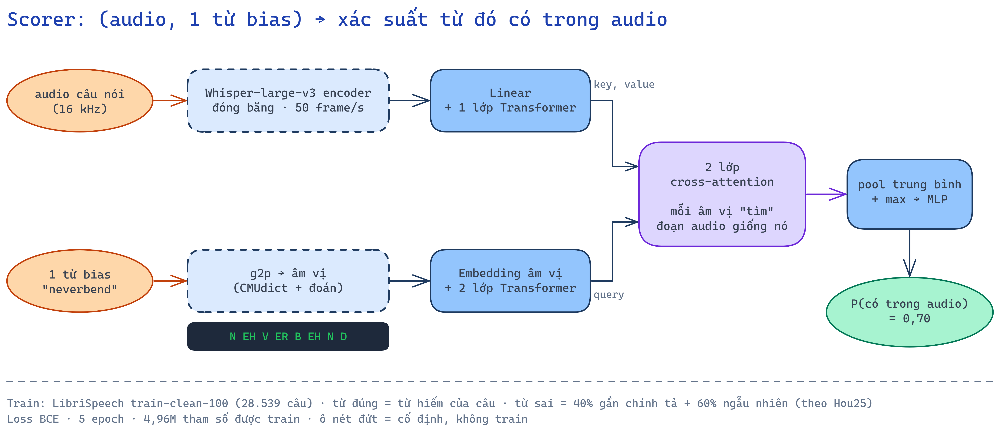

# scorer — chấm bias word theo audio

**Đầu vào:** audio 1 câu + bias list (vd 2000 từ của IS21). **Đầu ra:** cho mỗi từ một xác suất "từ này có được nói trong audio".
Dùng để lọc list trước khi đưa vào prompt ASR (Qwen3-ASR / Whisper). Ý tưởng xuất phát từ Hou25 (Interspeech 2025, `../related-work/hou25-ranking-selection.md`).
Kết quả: **`results.md`**. File của từng đợt chạy: **`runs/`**. Sơ đồ: **`docs/`**.
Nhãn nguồn của mọi lựa chọn: [A] theo paper, [B] thông lệ, [C] nhóm tự thiết kế.



## Thư mục
```
scorer/
  common.py            đường dẫn, encoder Whisper-large-v3 (đóng băng), BiasStore (feature TTS), PhoneStore (âm vị)
  models.py            hou25 | nocross | maxsim | pmaxsim | pxattn | hxattn  (+ score_chunks)
  data/
    build_train.py     ① train-clean-100 / dev-clean → train/dev.jsonl, near.json (negative khó), vocab.txt
    g2p.py             ② từ → âm vị ARPAbet (g2p_en, 14 s cho 217k từ)            ← cho pmaxsim / pxattn / hxattn
    tts.py             ②' edge-tts từng từ (~80 phút cho 209k từ)                  ← chỉ cho hou25 / nocross / maxsim
    encode_bias.py     ③' audio TTS → encoder Whisper → work/bias.f16 (21 GB)
    qwen_pass1.py      Qwen3-ASR không context → hyp lần 1 + nhãn "từ khó"         ← cho hxattn / worth
  training/train.py    ④ train 1 kiến trúc → work/ckpt/<arch>/{best,last}.pt
  inference/
    rank.py            ⑤ chấm list test → ctx_<name>_<L>.json (top-50) + ctx_<name>_<L>_p<thr>.json (lọc ngưỡng)
    eval_filter.py     đo riêng bộ lọc: Precision / Recall / số từ mỗi câu / % câu rỗng
    worth.py           "đáng bias" = có trong câu × chưa có trong hyp lần 1 (không train)
  docs/                sơ đồ excalidraw (+ png)
  runs/                kết quả đã kéo về từ server (xem runs/README.md)
  work/                output nặng, chỉ có trên server, KHÔNG đưa vào git
```
Mọi lệnh chạy từ trong `scorer/` dạng module: `python -m training.train ...`. Đổi thư mục output: `SCORER_WORK=/đường/dẫn`.

## Kiến trúc (`--arch`)
| arch | Ý tưởng | Bias biểu diễn bằng | Trạng thái | Nguồn |
|---|---|---|---|---|
| `hou25` | cross-attn 2 chiều → 4 ma trận cosine (frame × frame) → CNN 4 lớp | audio TTS | code xong, **chưa train** (feature TTS đã xoá) | [A] + chỗ trống [B] |
| `nocross` | như hou25, bỏ cross-attn (ablation) | audio TTS | chưa train | [C] |
| `maxsim` | mỗi frame của từ tìm frame audio khớp nhất, lấy trung bình; phía từ tính trước được | audio TTS | chưa train | [C] |
| `pmaxsim` | như maxsim | âm vị | ✅ train 5 epoch | [C] |
| **`pxattn`** | âm vị của từ "hỏi" vào audio qua 2 lớp cross-attention → pool mean+max → MLP → sigmoid | âm vị | ✅ **bản chính** | [C] |
| `hxattn` | như pxattn, bộ nhớ = audio + âm vị của hyp lần 1; 3 lớp (không có / có-dễ / có-khó) + softmax cả list có ô "không chọn" | âm vị | ✅ train, **kém** (nghi học tắt) | [C] |

**Lọc theo ngưỡng:** `rank.py --thr 0.5` giữ từ có xác suất ≥ 0.5 (tối đa 50) → list có thể rỗng. Thứ tự trong prompt: tăng dần theo điểm (Hou25 Bảng 3).
**Cascade:** `--pre <ckpt rẻ> --pre_k 200 --ckpt <ckpt kỹ>`. **Không cần list:** `--lists all` (kho 209k, chỉ với model rẻ ở tầng 1).

## Train (pxattn, xem `docs/training.png`)
- Dữ liệu: train-clean-100 (28.539 câu). Mỗi câu: từ đúng = từ hiếm của câu (ngoài 5k từ thông dụng, tối đa 8) [A];
  từ sai = 4 × số từ đúng [B]: 40% gần chính tả (`near.json`) + 60% ngẫu nhiên trong kho 209k [A]; không lấy từ có trong câu.
- Loss BCE theo từng cặp (câu, từ) [C — Hou25 ghi "softmax" nhưng không nói trên gì]. AdamW, lr 2e-4 (âm vị) / 5e-5 (TTS, theo Hou25) [A/B].
- 8 câu/bước, 5 epoch (~1 giờ/epoch, 1 RTX 4090). Chọn `best.pt` theo Recall@10 trên 500 câu dev-clean (list = từ đúng + 100 ngẫu nhiên).
  ⚠ Dev này quá dễ (99,7% từ epoch 0) → cần dev khó hơn (xem `../NEXT_STEPS.md`).

## Chỗ Hou25 không nói, ta tự chọn
- Encoder đóng băng; feature cắt theo độ dài thật; TTS cắt khoảng lặng (top_db=40), giọng en-US-AriaNeural [B]
- Linear 1280→368 dùng chung cho speech và bias; avg pool chỉ trên vùng không pad [B]
- Loss BCE theo cặp [C]; tỉ lệ pos:neg 1:4; tối đa 8 pos/câu [B]

## Chạy lại (server có GPU)
```bash
export LIBRI=/work/libri/LibriSpeech
python -m data.build_train --libri $LIBRI
python -m data.g2p
python -m training.train --arch pxattn --epochs 5 --lr 2e-4
for S in test-clean test-other; do
  python -m inference.rank --ckpt work/ckpt/pxattn/best.pt --name pxattn --split $S --libri $LIBRI \
      --lists N100 N500 N1000 N2000 missing_N2000 --thr 0.3 0.5 0.7
  python -m inference.eval_filter --prob work/out/pxattn/$S/prob_N2000.json --ref ../bench/protocol/$S/ref.tsv
done
cd ../bench
python run_qwen3asr.py --split test-clean --ctx pxattn_N2000_p0.5
python score.py --ref protocol/test-clean/ref.tsv --hyp out/test-clean/qwen3asr_pxattn_N2000_p0.5.raw.tsv --whisper-norm
```
Bản TTS (hou25): thêm `python -m data.tts && python -m data.encode_bias` trước khi train.
