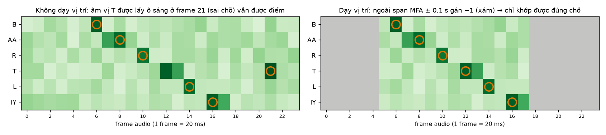
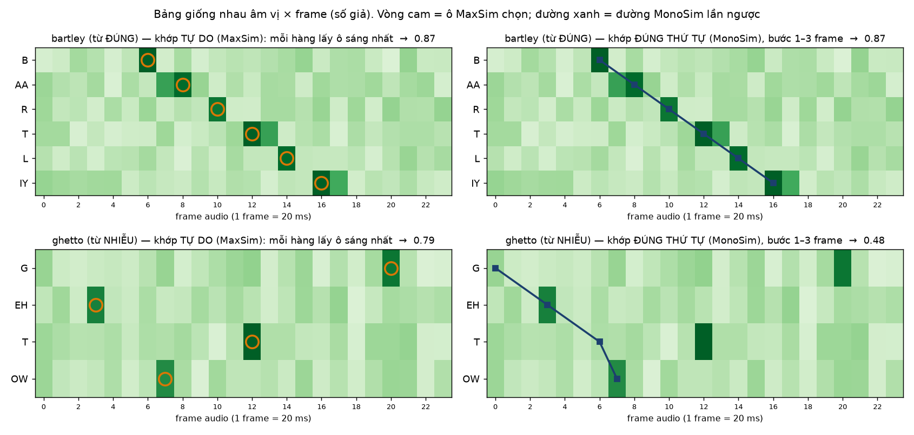
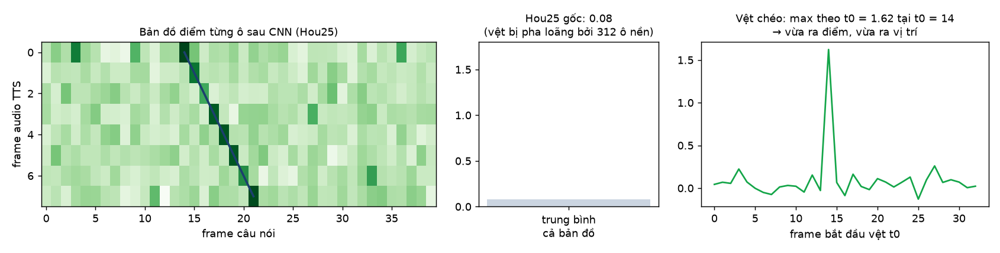

# Mổ xẻ bảng Recall@1: train ra sao, mỗi hệ chạy thế nào ra con số, âm vị và vị trí (18/11/2026)

Tài liệu để bắt kịp. Mọi số lấy từ log và file kết quả thật (nguồn ở cuối mỗi mục). Hình trong `imgs_moxe/` dùng **số giả** để minh hoạ cách tính; script vẽ: `fig_moxe.py` (tính MaxSim / MonoSim đúng như `models.py`).

Nhãn: **[đo]** = số chạy thật · **[code]** = đọc từ code · **[diễn giải]** = ý của mình, chưa kiểm.

---

## 0. Đọc trong 1 phút

| Hệ (test-other, list N2000) | Phía từ bias | Cách ra 1 điểm | Train | Recall@1 |
|---|---|---|---|---|
| Hou25 (nhóm tái hiện) | audio TTS của từ | CNN trên bản đồ giống nhau, rồi **trung bình cả bản đồ** | 2 epoch, chọn theo dev-clean | 72.6 |
| Hou25 vệt chéo | audio TTS | như trên, nhưng **lấy vệt chéo sáng nhất** | 2 epoch, chọn theo dev-clean | 82.9 |
| `pmaxsim_c4` | **chuỗi âm vị** | mỗi âm vị lấy frame giống nhất ở **bất kỳ đâu**, rồi trung bình | 6 epoch, chọn theo dev-other | 87.5 |
| `pmono_c4` | chuỗi âm vị | các âm vị phải khớp **đúng thứ tự, liền nhau** | 6 epoch, chọn theo dev-other | 85.8 |
| **`pdual2_dl` (đề xuất)** | chuỗi âm vị | **cộng hai cách trên**, mỗi cách một bản đồ riêng; **có dạy vị trí** | 6 epoch, chọn theo dev-other | **89.3** |

Mọi hệ dùng chung: cùng encoder Whisper-large-v3 đóng băng, cùng 28.539 câu train-clean-100, cùng cách lấy mẫu từ đúng / từ nhiễu, cùng loss BCE, cùng cách chấm test.
Khác nhau ở 3 chỗ: (1) từ bias được biểu diễn bằng gì, (2) bản đồ giống nhau được gộp thành 1 điểm ra sao, (3) có dạy vị trí hay không.

---

## 1. Recall@1 là gì? (một câu làm ví dụ)

Trong code và các file cũ, Recall@1 có tên là **Sạch@1** (`eval_e.py`, hàm `per_word` + `sach`) [code].

Ví dụ một câu test-other có 2 từ hiếm thật: `bartley`, `ambrose`. List của câu có 2 từ đúng này cộng 2000 từ nhiễu. Scorer chấm cả 2002 từ, xếp giảm dần theo điểm, giữ top-50:

```
hạng  từ        p      đúng/nhiễu   số NHIỄU đứng trên tính tới đây
 1    bartley   0.97   ĐÚNG         0      → bartley: 0 nhiễu đứng trên → TÍNH
 2    bentley   0.81   nhiễu        1
 3    ambrose   0.78   ĐÚNG         1      → ambrose: 1 nhiễu đứng trên → KHÔNG tính
 4    ...
```

- Mỗi từ đúng nhận một con số: **có bao nhiêu từ NHIỄU đứng trên nó**. Từ đúng khác đứng trên thì không bị trừ, vì câu có nhiều từ hiếm không nên bị phạt oan.
- Từ đúng rơi ra ngoài top-50 thì coi như có 50 nhiễu đứng trên.
- **Recall@1 = % từ đúng có 0 nhiễu đứng trên.** Câu ví dụ: 1/2 = 50%.
- Test-other có 2939 câu, 2141 câu có từ hiếm, tổng **5248 từ đúng** (mỗi từ khác nhau trong một câu tính một lần) [đo, `bench/protocol/test-other/ref.tsv`]. Recall@1 = 89.3 nghĩa là khoảng 4.687 / 5.248 từ đúng đứng trên mọi từ nhiễu.
- Khoảng tin cậy 95%: bốc lại ngẫu nhiên 2939 câu (có lặp) 1000 lần, tính lại hiệu hai hệ, lấy phân vị 2.5% và 97.5% (`eval_e.py` dòng 77–92) [code].

Vì sao không dùng "lọt top-50" như Hou25: ở mốc đó mọi hệ đều 95–99%, khác biệt bị che (REPORT-1115 §2).

---

## 2. Phần train: chung cho cả 5 hệ

### 2.1 Dữ liệu được dựng một lần

```
LibriSpeech train-clean-100 (28.539 câu, có transcript)
   │
   ├─ data/build_train.py → work/train.jsonl : mỗi câu {đường dẫn audio, mọi từ, "pos" = từ hiếm}
   │                        từ hiếm = từ KHÔNG nằm trong common_words_5k            [A: IS21]
   │                      → work/near.json    : mỗi từ hiếm → 20 từ gần chính tả nhất trong kho 209k
   │                                            (edit distance)  → làm "nhiễu khó"
   ├─ data/g2p.py         → work/phones.tsv   : mỗi từ → chuỗi âm vị ARPAbet (bỏ số trọng âm)  [B]
   │                        vd  bartley → B AA R T L IY    kirkland → K ER K L AH N D
   ├─ data/tts.py + encode_bias.py → bias.f16 : audio TTS (edge-tts) của từ → feature Whisper  (chỉ Hou25 cần)
   ├─ MFA căn chỉnh train-clean-100 → data/train_align.py → work/train_align.json
   │                        {câu: {từ: [[giây đầu, giây cuối]]}}                      (chỉ bản "dạy vị trí" cần)
   └─ data/cache_speech.py → speech_train.f16 (46 GB): feature encoder Whisper của mọi câu train
                            (encoder đóng băng nên tính một lần, các lần train sau đọc lại cho nhanh)
```

### 2.2 Một mẫu train trông thế nào (`training/train.py`, hàm `sample`) [code]

Lấy câu *"... met bartley at the gate ..."* (từ hiếm: `bartley`):

```
pos (nhãn 1) : bartley                                  ← từ hiếm thật của câu, tối đa 8 từ
neg (nhãn 0) : 4 × số pos = 4 từ                        ← tỉ lệ 1:4 [B, paper không nêu]
               40% (≈2 từ) lấy từ near.json             vd  bentley, bartlett      ("nhiễu khó")
               60% (≈2 từ) bốc ngẫu nhiên trong 209k    vd  kirkland, ghetto
               không lấy từ nào có mặt trong câu
```

Mỗi bước train lấy **8 câu** → mỗi epoch 28.539 / 8 ≈ **3568 bước** (đúng với log: `ep 0 step 3568`).

### 2.3 Loss: BCE trên từng cặp (câu, từ)

Scorer cho mỗi cặp một số `logit`, `p = sigmoid(logit)`.

```
bartley  p = 0.90  nhãn 1  → phạt  −log(0.90) = 0.11
bentley  p = 0.40  nhãn 0  → phạt  −log(0.60) = 0.51   ← nhiễu khó, bị phạt nhiều nhất
kirkland p = 0.05  nhãn 0  → phạt  −log(0.95) = 0.05
```

Cộng mọi cặp trong 8 câu, chia cho số cặp. AdamW, cắt gradient 1.0. lr 5e-5 cho Hou25 (theo paper) và 2e-4 cho scorer âm vị [code].

Ý nghĩa: model học *"từ này có được nói trong câu không"* cho từng từ một. Nó **không** được dạy trực tiếp *"đứng trên 2000 từ nhiễu"*. Recall@1 chỉ là thước đo lúc chọn ckpt và lúc test.

### 2.4 Dạy vị trí (cờ `--loc`, chỉ bản đề xuất và các bản `_loc` / `_dl`) [code: `train.py` dòng 111–122]

- Với **từ đúng**: chỉ được khớp trong đoạn MFA của nó, nới thêm ±0.1 s (= ±5 frame). Các frame khác trong bảng giống nhau bị gán −1.
- Với **từ nhiễu**: được khớp ở bất kỳ đâu (như cũ).



Tác dụng: nếu từ đúng "ăn điểm" nhờ một chỗ khác trong câu (hình trái: âm vị T lấy ô sáng ở frame 21, có thể là chữ "t" của từ sau), BCE sẽ không thưởng chỗ đó. Model buộc phải làm cho **đúng chỗ** sáng lên. Không thêm tham số nào; chỉ đổi cái mà loss nhìn thấy.

### 2.5 Chọn ckpt (khác nhau giữa các hệ, đây là chỗ không công bằng)

| | Dev dùng để chọn | Thước đo chọn | Epoch được chọn [đo, log] |
|---|---|---|---|
| Hou25 | 500 câu dev-clean, list = từ hiếm + 100 từ ngẫu nhiên | Recall@10 | ep 1 (98.28) / chạy 2 epoch |
| Hou25 vệt chéo | như trên | Recall@10 | ep 1 (99.60) / chạy 2 epoch |
| pmaxsim_c4 | 500 câu dev-other, list IS21 N2000 thật | Sạch@1 | ep 4 (88.17) / 6 epoch |
| pmono_c4 | như trên | Sạch@1 | **ep 0** (87.34) / 6 epoch |
| pdual2_dl | như trên | Sạch@1 | ep 2 (89.13) / 6 epoch |

- Lệnh Hou25 ghi `--epochs 3`, nhưng log chỉ có 2 lần đánh giá (ep 0, ep 1), tức chỉ chạy xong 2 epoch [đo].
- Dev 500 câu (~840 từ đúng) dao động mạnh: pdual2 lên xuống 86.6–89.1 giữa các epoch. Ckpt được chọn có nhiễu.
- `pdual2_dl` được chọn **theo test** trong 4 biến thể pdual (TIEN-DO-1117). Khi viết paper cần chọn lại bằng dev.

Nguồn: `runs/2026-11-14/logs/log_train_hou25.txt`, `log_train_e2.txt`, `log_train_c4.txt`, `log_train_dl.txt`.

### 2.6 Từ ckpt ra con số (giống nhau cho mọi hệ)

```
best.pt
  │  inference/rank.py --lists N2000 --span --win --split test-other
  │    · câu > 30 s: chia cửa sổ trượt 30 s, bước 25 s (--win), nếu không từ sau giây 30 bị sót
  │    · chấm cả 2002 từ của mỗi câu, xếp giảm dần, p = sigmoid(logit)
  ▼
work/out/<tên>/test-other/prob_N2000.json  (top-50 mỗi câu)  +  span_N2000.json (giây đầu/cuối)
  │  analysis/eval_e.py
  ▼
Sạch@1 / Sạch@5 / Sạch@10, báo nhầm theo độ dài câu, nhóm Whisper nghe sai, sai số tâm, % tâm trúng
```

---

## 3. Scorer âm vị: nhìn bằng hình

### 3.1 Hai phía, rồi một bảng

```
 AUDIO câu nói                                   TỪ BIAS "bartley"
 16 kHz                                          G2P:  B  AA  R  T  L  IY
   │ Whisper-large-v3 encoder (ĐÓNG BĂNG)          │ embedding âm vị + vị trí trong từ (0,1,2,…)
   ▼ 50 frame/giây, mỗi frame 1280 số              ▼ 2 lớp Transformer (256 chiều)
 Linear 1280→256 + 1 lớp Transformer             6 vector, mỗi âm vị một vector (256 số)
   ▼ chuẩn hoá độ dài = 1                          ▼ chuẩn hoá độ dài = 1
 T vector (mỗi frame 20 ms một vector)           không phụ thuộc câu → tính trước cho cả kho 209k
                     \                           /
                      ── tích vô hướng (cosine) ──
                                   ▼
               BẢNG GIỐNG NHAU M : 6 hàng (âm vị) × T cột (frame)
               M[p, t] ∈ [−1, 1] = "âm vị p giống frame t tới đâu"
```

Hệ quả thực tế:
- Chấm 2000 từ chỉ là **một phép nhân ma trận**, vì phía từ đã tính sẵn. Mất 4–7 ms/câu, so với ~1200 ms của Hou25, vốn phải chạy cross-attention + CNN cho từng từ [đo, REPORT-1115 §3].
- Từ mới (vd LLM vừa sinh ra) chấm được ngay, chỉ cần G2P, không cần TTS.

### 3.2 Hai cách đọc bảng thành một điểm



**Khớp tự do (MaxSim, `pmaxsim`)**: mỗi hàng (âm vị) lấy ô sáng nhất **ở bất kỳ đâu**, rồi lấy trung bình.
```
điểm = a · trung bình_p( max_t M[p,t] ) + c
```
- Từ đúng `bartley` (hình, hàng trên): 0.87.
- Từ nhiễu `ghetto` (hàng dưới): G lấy ô ở frame 20, EH ở frame 3, T ở frame 12 (mượn chữ T của "bartley"), OW ở frame 7. Bốn chỗ rời nhau, sai thứ tự, mà vẫn được **0.79**, sát từ đúng. Đây là kiểu nhiễu "gom điểm rời rạc".

**Khớp đúng thứ tự (MonoSim, `pmono`)**: tìm một **đường đi** từ âm vị đầu đến âm vị cuối; mỗi âm vị sau phải nằm sau âm vị trước 1–15 frame (≤ 0.3 s; hình thu nhỏ còn 1–3).
```
D[0, t] = M[0, t]
D[p, t] = M[p, t] + max_{1 ≤ g ≤ 15} D[p−1, t−g]          (quy hoạch động, P bước max-pool)
điểm   = a · max_t D[P−1, t] / P + c
```
- `bartley`: đường đi chéo xuống đúng chuỗi ô sáng → vẫn 0.87.
- `ghetto`: không có đường nào đi qua cả 4 ô sáng theo đúng thứ tự → tụt còn **0.48**.

Hai cách bù nhau [đo]:
- Khớp tự do ít **sót** hơn (Sạch@1 87.5 so với 85.8; list nghe giống 64.7 so với 60.5). Lý do [diễn giải]: âm thật bị nuốt hoặc nối âm thì đường đi đúng thứ tự bị gãy, còn khớp tự do vẫn nhặt được từng mảnh.
- Khớp đúng thứ tự ít **báo nhầm** hơn: câu ≥ 20 s có 0.9 so với 1.3 nhiễu p ≥ 0.5 mỗi câu. Nó cũng cho biên chắc hơn.

### 3.3 Bản đề xuất `pdual2`: hai nhánh trong một model (`models.py`, lớp `DualSim(two=True)`) [code]

```
audio ──► chiếu A (256) ─┐                      ┌─► bảng M_A ──► khớp ĐÚNG THỨ TỰ ─► s_mono ─┐
                         ├ cùng encoder Whisper │                                            ├─► a·s_mono + a2·s_free + c ─► sigmoid ─► p
âm vị ──► chiếu A (256) ─┘                      │                                            │
audio ──► chiếu B (256) ─┐                      │                                            │
                         ├──────────────────────┴─► bảng M_B ──► khớp TỰ DO ─────► s_free ──┘
âm vị ──► chiếu B (256) ─┘
```

- "2" = mỗi nhánh có bộ chiếu và bộ mã hoá âm vị riêng, nên ra **hai bảng khác nhau**. Tổng 5.45 M tham số [đo, log].
- Bản `pdual` dùng chung một bảng (2.72 M) chỉ được 88.3–88.4, không hơn các bản đơn có dạy vị trí. Muốn bù nhau thì hai nhánh phải nhìn khác nhau [đo, REPORT-1115 §7c].
- Hai vector nối lại thành 512 chiều, nên vẫn tính trước cho cả kho và vẫn là một phép nhân ma trận.
- `a`, `a2`, `c` là 3 số học được (khởi tạo 10, 10, −10).

---

## 4. Vị trí: ra từ đâu, đo thế nào

### 4.1 Mỗi hệ lấy vị trí ra sao [code: `models.py`]

| Hệ | Cách lấy [đầu, cuối] | Tự nhiên hay "chế thêm" |
|---|---|---|
| **pmono / pdual** | **Lần ngược đường đi** của MonoSim: frame của âm vị đầu → frame của âm vị cuối + 1 | Có sẵn từ phép tính điểm |
| pmaxsim | Tâm = **trung vị** các frame mà từng âm vị chọn; rộng = ±2 frame × số âm vị | Mẹo thêm [C] |
| Hou25 vệt chéo | Frame bắt đầu của vệt chéo cao nhất; dài = số frame audio TTS | Có sẵn từ phép tính điểm |
| Hou25 gốc | Tính vệt chéo trên bản đồ sau CNN **chỉ để lấy vị trí**; điểm vẫn là trung bình | Mẹo thêm |

Frame chia 50 ra giây (`rank.py`: `span / 50`).

Ví dụ hình 1: đường xanh của `bartley` đi từ frame 6 đến frame 16 → span = [6, 17) frame = **[0.12 s; 0.34 s]**.



Hou25 gốc lấy trung bình **cả bản đồ** (câu × audio TTS). Vệt sáng của từ đúng chỉ chiếm vài ô, nên bị hàng trăm ô nền pha loãng. Câu càng dài thì càng loãng, nên nhiễu dễ chen lên. Đọc theo vệt chéo thì điểm và vị trí là một [diễn giải; số đo ở mục 5].

### 4.2 Hai thước đo vị trí (`eval_e.py` mục 4–5) [code]

Mốc là đoạn MFA của từ đúng trong test (`bench/protocol/test-other/align.tsv`):

- **Sai số tâm** = |tâm span scorer đưa ra − tâm đoạn MFA|, lấy trung vị trên mọi từ đúng lọt top-50.
- **% tâm trúng** = % từ đúng có tâm nằm trong đoạn MFA ± 0.1 s.

Ví dụ: MFA nói `bartley` ở [0.10; 0.36] s, tâm 0.23 s. Scorer đưa ra [0.12; 0.34] s, tâm 0.23 s → sai 0.00 s, trúng.

| | Sai số tâm | % tâm trúng |
|---|---|---|
| Hou25 | 0.69 s | 44.0 |
| Hou25 vệt chéo | 0.05 s | 98.9 |
| pmaxsim_c4 | 0.05 s | 99.0 |
| pmono_c4 | **0.02 s** | 98.9 |
| pdual2_dl | **0.02 s** | **99.1** |

Lưu ý: dòng Hou25 (0.69 s / 44%) là ckpt cũ ở REPORT-1115 §3. Lần train lại cùng kiến trúc ở E2 (Recall@1 73.3) cho **0.06 s / 79.3%**. Hai số lệch nhau và chưa kiểm vì sao; có thể do hàm `diag_sum` được sửa ngày 14/11 (comment trong `models.py`). Cần chạy lại trước khi đưa vào paper.

### 4.3 Vị trí dùng vào việc gì

- **Lọc list**: hai từ có span chồng nhau > 30% thì chỉ giữ từ điểm cao hơn ("hai từ không thể cùng nằm một chỗ"). Ở p ≥ 0.5, precision của đề xuất lên 80.8 → 85.9% (TIEN-DO-1117).
- **Nhắc đúng lúc trong Whisper**: chỉ cộng điểm cho token của từ bias khi decoder đang "nghe" đúng đoạn audio đó. test-other B-WER 7.65, so với 9.69 của Hou25 prompt top-50 (REPORT-1115 §7c).

---

## 5. Từng hệ trong bảng: chạy gì ra số đó

Phần chung (mục 2) không nhắc lại. Mỗi thẻ chỉ ghi chỗ khác.

### ① Hou25 (nhóm tái hiện) → **72.6**
- **Model** (`models.Hou25`, 1.95 M tham số): feature câu nói và feature audio TTS của từ đi qua cùng một Linear 1280→368. Sau đó cross-attention hai chiều cho ra 4 bảng cosine. CNN 4 lớp nhận 4 bảng đó, rồi **trung bình mọi ô** → 1 logit [A + B, Hou25 §2.2].
- **Train**: `python -m training.train --arch hou25 --epochs 3 --lr 5e-5`. Không cache, encoder chạy trực tiếp. Xong 2 epoch; chọn ep 1 theo Recall@10 dev-clean (98.28).
- **Chấm**: `rank.py --ckpt work/ckpt/hou25/best.pt --name hou25_win --span --win` → `eval_e.py`. Khoảng 1200 ms/câu.
- **Số**: Recall@1 72.6, list nghe giống 51.4, nhóm Whisper nghe sai 45.9. Câu ≥ 20 s có 12.4 từ nhiễu p ≥ 0.5 mỗi câu (câu < 5 s: 1.4) [đo, REPORT-1115 §3].

### ② Hou25 vệt chéo → **82.9**
- **Model**: giống ① từng tham số. Chỉ khác bước cuối: thay "trung bình cả bản đồ" bằng "tổng trên đường chéo dốc 1, bắt đầu ở mọi frame t0, lấy max" (`pool="diag"`, hàm `diag_sum`). Đây là ý của Hoàng.
- **Train**: train **lại từ đầu** cùng một lượt với bản trung bình và bản top-k, để so công bằng: `--arch hou25 hou25_topk hou25_diag --tag _e2 --epochs 3 --lr 5e-5`. Xong 2 epoch; chọn ep 1 (Recall@10 dev-clean 99.60).
- **Chấm**: `rank.py --ckpt work/ckpt/hou25_diag_e2/best.pt --name hou25_diag_e2 --span --win`.
- **Số**: 82.9. Bản trung bình train cùng lượt được 73.3, top-k được 73.8. Δ = +9.5 [CI +7.9; +11.2]. Báo nhầm ở câu ≥ 20 s giảm 6.1 → 1.9 [đo, REPORT-1115 §5].
- **Điểm quan trọng**: nếu chỉ đổi cách gộp lúc test thì không lợi gì (thí nghiệm A1). Phải train lại thì CNN mới học vẽ vệt cho cách đọc mới.

### ③ pmaxsim_c4 (khớp tự do) → **87.5**
- **Model** (`models.MaxSim(n_phone=…)`, 2.72 M): xem mục 3.1–3.2.
- **Train**: `--arch pmaxsim pmono --cache train --dev_split dev-other --epochs 6 --lr 2e-4`. Train cùng lượt với ④ nên dùng chung batch và feature. Hậu tố `_c4` = cache feature + tỉ lệ nhiễu 4. Chọn ep 4 (Sạch@1 dev-other 88.17).
- **Chấm**: `rank.py --ckpt …/pmaxsim_c4/best.pt --span --win` → `eval_e.py`.
- **Số**: 87.5, list nghe giống 64.7, nghe sai 64.5, câu ≥ 20 s 1.3, sai số tâm 0.05 s [đo, `e_loc_other.md`].

### ④ pmono_c4 (khớp đúng thứ tự) → **85.8**
- **Model** (`models.MonoSim`, 2.72 M): giống ③, chỉ thay cách đọc bảng bằng đường đi đơn điệu (gap 15 frame).
- **Train**: cùng lệnh với ③. Ckpt tốt nhất ở **ep 0** (87.34); các epoch sau dev không lên.
- **Số**: 85.8, kém ③ 1.7 điểm [CI −2.7; −0.7]. Bù lại báo nhầm thấp nhất (0.9) và biên chặt nhất (0.02 s) [đo].

### ⑤ pdual2_dl (đề xuất) → **89.3**
- **Model** (`models.DualSim(two=True)`, 5.45 M): ③ + ④ trong một model, mỗi nhánh có bảng riêng (mục 3.3).
- **Train**: train cùng lượt với `pdual`, **thêm `--loc`** (dạy vị trí, mục 2.4); `dl` = dual + loc. Chọn ep 2 (Sạch@1 dev-other 89.13). Log: `log_train_dl.txt`. Dòng lệnh không có trong `scripts/`; các tham số còn lại (cache, dev-other, 6 epoch, lr 2e-4) suy ra từ log và cờ của lượt c4.
- **Chấm**: như ③.
- **Số**: 89.3 (+1.8 [CI +0.9; +2.6] so với ③), list nghe giống 67.7, nghe sai 70.9, câu ≥ 20 s 0.9, sai số tâm 0.02 s, 99.1% tâm trúng [đo, `e_dual_other.md`, REPORT-1115 §7c].

### Bóc tách: mỗi bước cộng thêm bao nhiêu (đều train trên clean-100, 6 epoch) [đo]

```
72.6  Hou25 tái hiện
 │ +10.3   Hou25 đọc theo vệt chéo, train lại                     (②; mốc cùng lượt là 73.3 → +9.5)
82.9
 │ +4.6    đổi audio TTS → chuỗi âm vị, khớp tự do                 (③; LẪN cả 2→6 epoch và dev khác, mục 6)
87.5
 │ +0.8    thêm dạy vị trí                                         (pmaxsim_loc 88.3)
88.3
 │ +1.0    thêm nhánh đúng thứ tự, bảng riêng, cùng một model      (⑤ 89.3)
89.3
 │ (+1.5   nếu thay bằng cộng điểm 2 model train riêng: 90.8; đây là trần, chưa phải một model)
```

Hai chỗ nhảy lớn nhất [diễn giải]: (1) **đọc theo hình vệt**: điểm phải đến từ một chuỗi frame liền nhau thay vì trung bình cả bảng; (2) **biểu diễn từ bằng âm vị** thay vì audio TTS. Dạy vị trí và hai nhánh mỗi thứ chỉ thêm khoảng 1 điểm, nhưng hai nhánh là thứ kéo báo nhầm và biên xuống.

---

## 6. Chỗ chưa công bằng / cần làm lại trước khi viết paper

1. **Số epoch và dev khác nhau**: Hou25 2 epoch, chọn theo Recall@10 dev-clean (dễ, list 100). Scorer âm vị 6 epoch, chọn theo Sạch@1 dev-other N2000. Muốn so sạch thì Hou25 (cả hai bản) nên train 6 epoch và chọn theo cùng dev.
2. **`pdual2_dl` được chọn theo test** trong 4 biến thể → cần chọn lại bằng dev, hoặc báo cả 4.
3. **Dev 500 câu quá ồn** (dao động 2–3 điểm giữa các epoch) → dùng cả dev-other hoặc lấy trung bình ckpt.
4. **Vị trí Hou25**: 0.69 s (§3) so với 0.06 s (E2), chưa rõ vì sao (mục 4.2).
5. **1 seed** cho mọi dòng. Các CI ở trên chỉ phản ánh biến động theo câu, chưa tính biến động theo lần train.
6. Câu ≥ 20 s chỉ có **40 câu** → các số báo nhầm ở cột này rất ồn.

---

## Nguồn

| Nội dung | File |
|---|---|
| Kiến trúc, cách lấy vị trí | `scorer/models.py` (Hou25 dòng 46–92, MaxSim 110–148, MonoSim 151–189, DualSim 192–225) |
| Lấy mẫu, loss, dạy vị trí, chọn ckpt | `scorer/training/train.py` (sample 73–88, loc 111–122, loss 150–163, evaluate 166–184) |
| Chấm test, cửa sổ trượt, span ra giây | `scorer/inference/rank.py`, `scorer/common.py` |
| Công thức Sạch@1, vị trí | `scorer/analysis/eval_e.py` |
| Log train | `scorer/runs/2026-11-14/logs/log_train_{hou25,e2,c4,loc,dl}.txt` |
| Bảng số | `REPORT-1115.md` §3, §5, §6, §6c, §7c; `e_loc_other.md`; `e_dual_other.md`; `TIEN-DO-1117.md` §2.1 |
| Hình minh hoạ | `scorer/analysis/fig_moxe.py` → `imgs_moxe/` |
