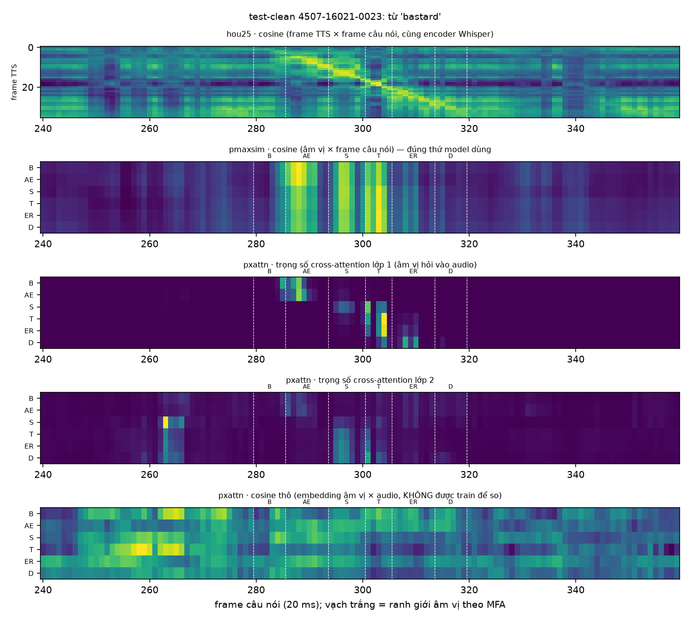
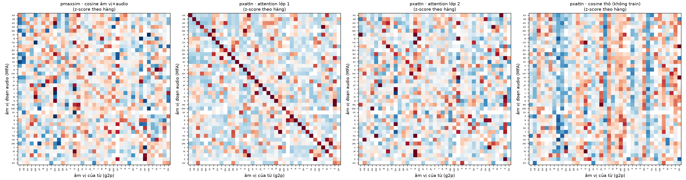

# Vị trí và "ngôn ngữ chung" của scorer: bản đồ audio × từ có biết từ nằm ở đâu không, khi một phía là âm vị?
> Code: `position.py` (trích bản đồ + đo), `summarize.py` (bảng + hình), `pipe.sh` · Cập nhật: 02/11/2026
> Phạm vi: 3 scorer đã train trên train-clean-100 (pxattn, pmaxsim — phía từ là âm vị; hou25 tái hiện — phía từ là audio TTS),
> LibriSpeech test-clean / test-other, 400 câu có từ hiếm mỗi tập, list IS21 N100. Chạy CPU (4 card GPU đang bận).

## Tóm tắt

| RQ | Câu hỏi | Trả lời (clean / other) | Độ chắc |
|---|---|---|---|
| Q1 | Bản đồ có định vị được từ không? | **Có, ở bản đồ mà model thật sự dùng để so.** Sai số trung vị: pxattn attention lớp 1 = 0,03 / 0,03 s, pmaxsim cosine = 0,04 / 0,03 s, hou25 S1 = 0,06 / 0,06 s. Tỉ lệ trúng span: 99,5 / 99,2%, 99,8 / 99,3%, 98,9 / 96,7%. **Không** với attention lớp 2 (≈ 50%) và cosine thô của pxattn (8,8 / 12,3%, ngang mốc ngẫu nhiên 10,2 / 12,4%) | chắc (≈ 1.000 từ mỗi tập; cách biệt rất xa mốc) |
| Q2 | Bên trong từ, âm vị có đỉnh đúng chỗ, đúng thứ tự không? | **pxattn lớp 1: có — căn chỉnh tới mức âm vị.** 66,9 / 64,5% âm vị có đỉnh nằm trong chính đoạn âm vị của nó (~0,1 s), mốc may rủi 1,2 / 1,4%. **pmaxsim: chỉ biết "cả từ ở đâu"**: các âm vị dồn chung đỉnh (đỉnh khác nhau chỉ 38% số âm vị, 22–28% số từ gần như chung một đỉnh, so với 1,6–2,4% ở pxattn) | chắc về hướng |
| Q3 | Hai phía (vector audio / id âm vị) có gặp nhau ở mức *loại* âm vị không? | **Chỉ trong attention lớp 1 của pxattn.** Ma trận 39×39 có đường chéo lớn nhất ở 69% hàng, hạng trung bình của đường chéo 1,5/39. pmaxsim: 5% (hạng 4,6). Cosine thô: 0% (hạng 21,2 ≈ ngẫu nhiên) | chắc về hướng |
| Q4 | Nhánh audio của scorer có "âm vị hoá" feature Whisper không? | **Không.** Probe tuyến tính 39 âm vị trên nhánh audio ≈ chiếu ngẫu nhiên cùng số chiều: pxattn 66,7 / 58,6% và pmaxsim 67,8 / 59,9%, so với ngẫu nhiên 256 chiều 67,5–68,1 / 60,5–61,0%. Whisper thô đạt 79,7 / 71,3% | chắc (3 seed mốc, nhiễu ±0,3) |
| Q5 | Đỉnh theo thời gian có tách từ đúng / nhiễu tốt hơn xác suất của scorer không? | Không. Xác suất đạt AUC 0,995–1,000; đỉnh của pxattn lớp 1 thấp hơn (0,97). Trục thời gian cho **vị trí**, không cho thêm **có / không** (khớp F14 của Hoàng) | chắc về hướng (từ nhiễu dễ) |

**Kết luận chính.**
- **"Cosine similarity matrix" chỉ mang vị trí khi cosine chính là phép so mà model được train.** Với scorer âm vị, nguồn vị trí đúng là:
  - cosine của **pmaxsim**: vị trí của cả từ;
  - **trọng số cross-attention lớp 1 của pxattn**: vị trí của từng âm vị.
- Cosine giữa hai không gian chưa từng được train để so thì cho kết quả ngang ngẫu nhiên.
- Dù audio không phải âm vị, scorer âm vị vẫn định vị **ngang hoặc tốt hơn** Hou25 dùng TTS (0,03 so với 0,06 s), mà không cần TTS.
- Việc ghép hai loại feature xảy ra **trong phép chiếu q/k của attention**, không phải do nhánh audio biến thành "âm vị".

**Khuyến nghị cho hướng "scorer cấp vị trí cho mô hình nghe":**
- Lấy thời gian từ **attention lớp 1 của pxattn** (có cả mốc từng âm vị), hoặc từ cosine của pmaxsim (chỉ mốc cả từ).
- Chỉ dùng thời gian cho các từ scorer tin là có. F15 của Hoàng cho thấy đặt từ nhiễu theo "thời gian" của chúng thì có hại.

## 1. Mục tiêu và câu hỏi

**Bối cảnh.** Hướng đi tiếp của nhóm (họp 11/2026, ý 3) là cho scorer cung cấp **vị trí** của bias word cho mô hình nghe phía sau, thay vì chỉ đưa list chữ vào prompt. Repo tái hiện Hou25 của Hoàng (`itshoang2024/hou25_interspeech`, NOTES F13–F16) đã cho thấy hai điều với scorer **Hou25**, tức phía từ là audio TTS đi qua cùng encoder Whisper:
- Ma trận cosine S1 (frame TTS × frame câu nói) có một vệt chéo nằm đúng chỗ từ được nói. Sai số trung vị 0,05 s; 99,4% / 98,8% số từ rơi trong span.
- Dùng thời gian này để sắp prompt ("hybrid") giảm B-WER thêm 0,17 / 0,41 điểm.

Scorer của nhóm thì khác ở chỗ quan trọng nhất: **hai phía không cùng một loại feature**.
- Phía câu nói là vector encoder Whisper: liên tục, 20 ms/frame, mang cả âm, giọng, ngữ cảnh.
- Phía từ là chuỗi **id âm vị** rời rạc (g2p) đi qua embedding + Transformer: không có thời lượng, mỗi âm vị là một token.

Vì vậy kết quả của Hou25 không tự động đúng cho scorer âm vị. Cần đo lại.

| RQ | Câu hỏi | Giả thuyết |
|---|---|---|
| Q1 | Bản đồ (đơn vị của từ × frame) của từng scorer có đỉnh đúng chỗ từ được nói không? | Có với các bản đồ mà model *thực sự dùng để so* (cosine của pmaxsim, attention của pxattn). Không với cosine "thô" giữa hai không gian chưa từng được train để so bằng cosine. |
| Q2 | Bên trong một từ, âm vị thứ j có đỉnh ở đúng đoạn âm vị j của audio, và các đỉnh có đi theo thứ tự không? | pxattn (attention theo từng âm vị): có thứ tự. pmaxsim (max theo thời gian, rồi trung bình): không cần thứ tự nên có thể không có. |
| Q3 | Một đoạn âm vị của audio "nhận ra" đúng hàng âm vị của từ không? Ma trận loại âm vị audio × loại âm vị chữ có trội đường chéo không? | Có nếu hai phía thật sự gặp nhau ở mức âm vị. Nếu chỉ khớp ở mức "cả từ" thì không. |
| Q4 | Nhánh audio của scorer (sau Linear + 1 lớp Transformer) có còn mang thông tin âm vị không, so với feature Whisper thô? | Whisper thô mang nhiều âm vị (là encoder ASR). Nhánh audio của scorer âm vị giữ lại nhiều hơn nhánh của hou25. |
| Q5 | Độ cao đỉnh trên trục thời gian có phân biệt từ đúng / từ nhiễu tốt hơn xác suất của scorer không? | Không. F14 của Hoàng: AUC ngang nhau, trục thời gian thêm *vị trí* chứ không thêm *có/không*. |

### 1.1 Prior → arm
- **Hou25 / F14 (repo Hoàng, đã chạy):**
  - Cosine frame TTS × frame câu nói có vệt chéo dốc ≈ 1, vì hai phía cùng là audio, cùng encoder, cùng tốc độ 50 frame/s.
  - Sai số 0,05 s. Ngay cả scorer bỏ cross-attention (chỉ S1) cũng định vị tốt như vậy.
  - → **Arm mốc: hou25 tái hiện của nhóm** (khác ckpt với của Hoàng), đo lại bằng **cùng** mốc thời gian MFA để so ngang hàng.
- **pmaxsim (nhóm, kiểu ColBERT):**
  - Điểm = trung bình theo âm vị của max theo thời gian của cosine.
  - Hàm mục tiêu chỉ ép "mỗi âm vị có một frame khớp ở đâu đó", không ép thứ tự.
  - → **Arm:** cosine âm vị × frame, đúng ma trận mà model dùng.
- **pxattn (nhóm):**
  - Âm vị là query, attend vào frame audio qua 2 lớp `TransformerDecoderLayer`. Trọng số attention là "nhìn vào đâu".
  - → **Arm:** attention lớp 1, attention lớp 2 (trung bình 4 head).
- **Đối chứng âm:** cosine giữa đầu ra encoder âm vị và nhánh audio của pxattn. Hai không gian này **không** bao giờ được so bằng cosine khi train: attention dùng phép chiếu q/k riêng.
  - Nếu "cosine matrix nào cũng ra vị trí" thì arm này cũng định vị được.
  - Nếu chỉ phép so đã được train mới mang vị trí thì arm này ≈ ngẫu nhiên.
- **Mốc thời gian dummy:** giữa câu, ngẫu nhiên đều.

**Tiêu chí, chốt trước khi xem số:**

| Mục | Kết luận | Điều kiện |
|---|---|---|
| Q1 | "Mang vị trí" | Trung vị \|err\| ≤ 0,1 s **và** ≥ 90% số từ trúng span ±0,2 s, trên cả hai tập |
| Q1 | "Không mang" | ≤ 2 lần mốc ngẫu nhiên |
| Q2 | "Có thứ tự âm vị" | Tỉ lệ đơn điệu và Spearman cao hơn hẳn mức may rủi; tỉ lệ đỉnh trúng đoạn âm vị của chính nó ≫ mốc may rủi (đỉnh rơi ngẫu nhiên trong câu) |
| Q3 | "Gặp nhau ở mức âm vị" | Đoạn audio → đúng hàng âm vị ≫ 1/P; trong ma trận 39×39, phần lớn hàng có đường chéo lớn nhất |

## 2. Setup

| Hạng mục | Giá trị |
|---|---|
| Scorer | `work/ckpt/{pxattn,pmaxsim,hou25}/best.pt` — đúng các ckpt của Bảng 1 / §7–8 `results.md` (train-clean-100) |
| Encoder câu nói | Whisper-large-v3 đóng băng, pad 30 s, cắt theo độ dài thật (như `common.Encoder`), fp32 trên CPU, lưu fp16 |
| Câu | 400 câu ngẫu nhiên (seed 0) trong số câu có từ hiếm và có căn chỉnh MFA, mỗi tập |
| Ứng viên mỗi câu | các từ hiếm đúng + 20 từ nhiễu rút ngẫu nhiên từ list IS21 N100 của câu (chỉ dùng cho Q5) |
| Mốc thời gian thật | MFA alignment của LibriSpeech (Lugosch et al. 2019, zenodo 2619474): tier `words` + `phones` (ARPAbet có trọng âm → bỏ số trọng âm, 39 âm vị, đúng bộ của `common.PHONES`). Scorer không bao giờ thấy alignment này |
| Bản đồ | hou25: `S1 = cos(proj(frame TTS), proj(frame câu))`. pmaxsim: `cos(enc_bias, enc_speech)`. pxattn: trọng số `multihead_attn` lớp 1, lớp 2 (TB 4 head) + cosine thô `cos(pe(âm vị), ts(ls(câu)))` |

**Ước lượng thời điểm của từ** từ bản đồ M (hàng = đơn vị của từ, cột = frame):

| Tên | Cách tính |
|---|---|
| `prof` | argmax theo thời gian của trung bình các hàng |
| `med` | trung vị của argmax từng hàng |
| `streak` | đường chéo có trung bình lớn nhất (như F14). Hou25 thử độ dốc 0,67 / 1 / 1,5 frame câu cho mỗi frame TTS; âm vị thử 2–8 frame mỗi âm vị |

**Metric:**
- \|err\| = khoảng cách tới tâm của lần xuất hiện gần nhất.
- "trúng span" = nằm trong [đầu − 0,2 s, cuối + 0,2 s], như F14.
- "mass trong span" (chỉ cho attention) = phần trọng số rơi vào span từ; "chance" = độ dài span / độ dài câu.

**Q2/Q3:** chỉ dùng những từ mà chuỗi âm vị MFA trùng chuỗi g2p, để hàng j ↔ đoạn j là một-một.
- "Đỉnh trong đoạn của chính nó": cho phép lệch ±1 frame.
- "Lệch chỉ số": |đoạn chứa đỉnh − j|.
- "Đơn điệu": các đỉnh không giảm theo j (chỉ xét từ có ≥ 3 âm vị).
- "Đoạn audio → đúng hàng": với mỗi đoạn âm vị MFA, hàng nào có trung bình M trên đoạn lớn nhất. Mức may rủi = 1/P.
- Ma trận 39×39: cộng dồn M (hàng = loại âm vị của đoạn audio, cột = loại âm vị của hàng chữ) trên mọi cặp trong cùng một từ, chuẩn hoá z-score theo hàng.

**Q4:** probe tuyến tính (logistic, 15 epoch, Adam) đoán âm vị MFA của **từng frame**.
- Chia người nói 50/50: train một nửa người nói, test nửa còn lại.
- Feature so sánh:
  - Whisper thô (1280 chiều)
  - nhánh audio của từng scorer: pxattn 256, pmaxsim 256 (đã chuẩn hoá), hou25 368 (chỉ phép chiếu)
  - chiếu ngẫu nhiên 1280→256 và 1280→368, 3 seed mỗi loại, làm mốc "cùng số chiều, không học" (`probe_rand.py`)

**Sự cố kỹ thuật đã xử lý (quan trọng cho tái lập):**
- Bản torch trong image `nvcr.io/nvidia/pytorch:26.08` (2.14 alpha) trên **CPU** cho logit cross-attention **sai, và đổi theo số luồng**.
- Ví dụ cùng một câu và một từ: 3,548 với 1–4 luồng (= tính tay bằng softmax); 3,365 với 8 luồng; 3,385 với 32 luồng.
- Thủ phạm là kernel SDPA đa luồng. Ép `sdpa_kernel(SDPBackend.MATH)` thì khớp tính tay ở mọi số luồng.
- Feature Whisper không bị ảnh hưởng: so sdpa/eager, 4/8 luồng, lệch ≤ 0,008, tức làm tròn fp16.
- Mọi kết quả GPU trước đây không liên quan tới lỗi này.

## 3. Kết quả

Số câu thực dùng: 395 (clean) / 394 (other) câu có ít nhất 1 từ hiếm đúng chấm được. Gồm 1.085 / 979 từ hiếm đúng và 20 từ nhiễu mỗi câu.
Bảng đầy đủ (cả 3 cách ước lượng): `summary.md`, `extra.md`. Hình: `imgs/`.



### Q1: Bản đồ có định vị được từ không?

**Câu hỏi.** Đỉnh của bản đồ trên trục thời gian có rơi vào đúng chỗ từ được nói (theo MFA) không?
**Giả thuyết.** Có, với cosine của pmaxsim và attention của pxattn. Không, với cosine thô.

**Kết quả.** Ước lượng `streak`. Các ước lượng khác xem `summary.md`: `med` cho kết quả gần như nhau; `prof` kém hơn với hou25 (0,10 s; 82 / 80%) vì nền cosine TTS cao.

| Bản đồ | clean: trung vị \|err\| (s) / trúng span (%) | other | Phần attention rơi trong span (chance) |
|---|---|---|---|
| hou25 · S1 cosine TTS × câu nói (mốc) | 0,06 / 98,9 | 0,06 / 96,7 | – |
| pmaxsim · cosine âm vị × câu nói | 0,04 / 99,8 | 0,03 / 99,3 | – |
| **pxattn · attention lớp 1** | **0,03 / 99,5** | **0,03 / 99,2** | 0,87 / 0,84 (0,07 / 0,08) |
| pxattn · attention lớp 2 | 0,45 / 49,9 | 0,38 / 50,6 | 0,16 / 0,18 |
| pxattn · cosine thô (đối chứng âm) | 2,54 / 8,8 | 2,05 / 12,3 | – |
| mốc: giữa câu | 1,95 / 14,6 | 1,54 / 16,6 | |
| mốc: ngẫu nhiên đều | 2,52 / 10,2 | 1,95 / 12,4 | |
| _tham khảo: Hou25 của Hoàng (F14, ckpt khác, alignment wav2vec2)_ | _0,05 / 99,4_ | _0,05 / 98,8_ | |

Các từ đúng mà scorer **nghi ngờ** (p < 0,5) vẫn được định vị (`extra.md`):

| Bản đồ | p < 0,5: số từ / trung vị \|err\| / trúng span (%), clean | other |
|---|---|---|
| hou25 | 62 / 0,07 / 91,9 | 122 / 0,06 / 84,4 |
| pmaxsim | 36 / 0,04 / 97,2 | 89 / 0,04 / 93,3 |
| pxattn lớp 1 | 51 / 0,03 / 100 | 115 / 0,04 / 93,9 |

**Rút ra được gì**
- Cosine pmaxsim và attention lớp 1 của pxattn đều định vị chính xác: sai số 1,5–2 frame (0,03–0,04 s); ~99% số từ trúng span ở cả hai tập. Kết quả này tốt hơn mốc Hou25 đo cùng cách (0,06 s; 98,9 / 96,7%). → khớp giả thuyết, đạt tiêu chí "mang vị trí".
- Attention lớp 1 dồn **84–87% trọng số vào đúng từ**, trong khi từ chỉ chiếm 7–8% độ dài câu.
- **Attention lớp 2 không còn là bản đồ vị trí:** ~50% trúng span. Lớp 2 nhìn ra ngữ cảnh xung quanh (hình ví dụ). Vị trí phải đọc ở lớp 1.
- **Đối chứng âm đúng như dự đoán:** cosine thô giữa đầu ra encoder âm vị và nhánh audio của pxattn ngang mốc ngẫu nhiên, đạt tiêu chí "không mang". Hai vector này chưa bao giờ được so bằng cosine khi train: attention so qua phép chiếu q, k riêng.
- Từ đúng mà scorer nghi ngờ vẫn được đặt đúng chỗ ở 93–100% số trường hợp với 2 scorer âm vị. hou25 tụt nhiều hơn (84–92%).

**Kết luận.** **Scorer âm vị biết từ nằm ở đâu, chính xác ngang hoặc hơn Hou25 dùng TTS. Nguồn vị trí là cosine của pmaxsim hoặc attention lớp 1 của pxattn, không phải cosine bất kỳ của hai feature.**
**Caveat.** 400 câu mỗi tập. Mỗi scorer 1 checkpoint (hou25 chỉ 2 epoch). MFA có sai số cỡ 10–20 ms.

### Q2: Bên trong một từ, âm vị có đỉnh đúng chỗ, đúng thứ tự không?

**Câu hỏi.** Hàng âm vị thứ j có đỉnh trong đoạn âm vị thứ j của audio (MFA) không? Hay mọi âm vị sáng cùng một chỗ?
**Giả thuyết.** pxattn: có, vì mỗi âm vị là một query riêng. pmaxsim: không cần, vì hàm điểm là max theo thời gian rồi trung bình, không quan tâm thứ tự.

**Setup riêng.**
- Chỉ dùng từ có chuỗi âm vị g2p trùng hoàn toàn MFA: 89,0 / 83,9% số từ.
- Một đoạn âm vị dài trung bình 0,099 / 0,096 s, tức 4,8–4,9 frame.
- Mốc may rủi: một đỉnh rơi ngẫu nhiên trong câu thì trúng đoạn của chính nó 1,2 / 1,4%.

**Kết quả** (clean / other)

| Bản đồ | Đỉnh trong đoạn của chính nó (%) | Lệch chỉ số âm vị (TB) | Đoạn audio → đúng hàng (%) (may rủi 17,5 / 19,1) | Số đỉnh khác nhau / số âm vị | (Đỉnh cuối − đầu) / độ dài từ | Từ có ≥ 80% âm vị chung 1 đỉnh (%) |
|---|---|---|---|---|---|---|
| pmaxsim · cosine | 54,2 / 52,1 | 0,92 / 0,94 | 47,0 / 47,4 | 0,38 / 0,38 | 0,25 / 0,23 | 22,1 / 28,4 |
| **pxattn · attention lớp 1** | **66,9 / 64,5** | **0,64 / 0,67** | **65,0 / 64,0** | 0,66 / 0,66 | 0,50 / 0,45 | 1,6 / 2,4 |
| pxattn · attention lớp 2 | 14,8 / 15,6 | 1,29 / 1,30 | 36,2 / 35,0 | 0,62 / 0,62 | −0,51 / 0,04 | 5,5 / 9,1 |
| pxattn · cosine thô | 1,3 / 1,8 | 2,85 / 2,60 | 15,7 / 16,8 | 0,90 / 0,90 | −0,63 / −0,14 | 0,7 / 0,7 |

**Rút ra được gì**
- **pxattn lớp 1 căn chỉnh tới mức âm vị:**
  - 2/3 số âm vị có đỉnh nằm đúng trong đoạn ~0,1 s của chính nó, gấp ~50 lần may rủi.
  - Lệch trung bình 0,65 âm vị.
  - Đỉnh trải dài theo đúng chiều, tạo dạng "bậc thang" như ở hình trên.
- **pmaxsim chủ yếu định vị cả từ:**
  - Các hàng âm vị sáng thành **dải dọc** cùng chỗ: chỉ 38% số âm vị có đỉnh riêng, đỉnh đầu và cuối cách nhau 1/4 độ dài từ, và 22–28% số từ có gần như mọi âm vị chung một đỉnh.
  - Vẫn trên may rủi (47% đoạn → đúng hàng), nên còn một phần thông tin âm vị.
- Tiêu chí ở §1 có dùng "đơn điệu" và Spearman (`summary.md`: pmaxsim 93,5 / 92,4% và 0,97; pxattn lớp 1 81,9 / 79,5% và 0,95 / 0,92). Hai chỉ số này **bị thổi phồng với pmaxsim**: các âm vị chung đỉnh vẫn được tính là "không giảm", và cách xếp hạng tách hoà theo thứ tự hàng. Vì vậy bỏ hai chỉ số này, dùng các cột ở bảng trên.

**Kết luận.** **pxattn (lớp 1) biết vị trí từng âm vị theo đúng thứ tự. pmaxsim chủ yếu chỉ biết vị trí cả từ.** Điều này khớp hàm mục tiêu: max-sim không bị phạt khi cả từ khớp vào cùng một cụm frame.
**Diễn giải (chưa kiểm):** đây có thể là lý do pmaxsim dễ bị lừa nhất bởi từ nghe giống. Recall_H#50 (`results.md` §8) là 25,5, so với pxattn 21,6 và Hou25 17,6, tức thứ tự cấu trúc càng ít thì càng dễ nhầm. Muốn kiểm: đo bản đồ của các từ nhiễu khó (`hard_N2000`) tại chỗ của từ gốc.

### Q3: Hai loại feature có gặp nhau ở mức *loại* âm vị không?

**Câu hỏi.** Gộp mọi cặp (đoạn audio có âm vị X theo MFA, hàng chữ có âm vị Y) trong cùng một từ. Giá trị bản đồ có lớn nhất khi X = Y không?

**Kết quả** (gộp 2 tập, z-score theo hàng)



| Bản đồ | Hàng có đường chéo lớn nhất (%) | Hạng TB của đường chéo / 39 |
|---|---|---|
| pmaxsim · cosine | 5,1 | 4,6 |
| **pxattn · attention lớp 1** | **69,2** | **1,5** |
| pxattn · attention lớp 2 | 5,1 | 5,3 |
| pxattn · cosine thô | 0 | 21,2 (≈ ngẫu nhiên 20) |

**Rút ra được gì**
- Chỉ attention lớp 1 có đường chéo rõ: query của âm vị AE nhìn vào frame mà MFA gán AE, và tương tự với hầu hết 39 âm vị.
- pmaxsim và lớp 2 có tín hiệu loại âm vị yếu: hạng 4,6–5,3, tốt hơn ngẫu nhiên nhưng hiếm khi đứng đầu.
- **Caveat:**
  - Trong một từ, cặp X = Y thường cũng là cặp đúng vị trí, nên "trùng loại" và "trùng chỗ" bị lẫn vào nhau.
  - Với pmaxsim, dải dọc làm các cột của cùng một từ gần như bằng nhau.

**Kết luận.** **Vector Whisper và id âm vị chỉ thật sự gặp nhau ở mức âm vị trong phép chiếu q/k của attention lớp 1 (pxattn).**

### Q4: Nhánh audio của scorer có biến feature Whisper thành "âm vị" không?

**Câu hỏi.** Sau Linear + 1 lớp Transformer, frame audio của scorer có dễ đoán âm vị hơn không? Câu hỏi này cho biết scorer có "ép audio thành âm vị cho khớp phía chữ" hay không.
**Setup.** Probe tuyến tính 39 âm vị/frame, chia người nói 50/50; 145k / 118k frame. Mốc chiếu ngẫu nhiên chạy 3 seed.

| Feature | Số chiều | clean (%) | other (%) |
|---|---|---|---|
| Whisper-large-v3 thô | 1280 | 79,7 (3 seed: 79,6–79,7) | 71,3 (71,2 ×3) |
| chiếu ngẫu nhiên | 256 | 67,5 / 68,0 / 68,1 | 60,6 / 61,0 / 60,5 |
| pxattn · nhánh audio | 256 | 66,7 | 58,6 |
| pmaxsim · nhánh audio | 256 | 67,8 | 59,9 |
| chiếu ngẫu nhiên | 368 | 71,6 / 71,4 / 71,6 | 64,4 / 64,1 / 64,1 |
| hou25 · phép chiếu | 368 | 72,3 | 64,8 |
| đoán lớp nhiều nhất | | 7,9 | 7,8 |

**Rút ra được gì**
- Feature Whisper đã mang âm vị dạng tuyến tính khá đầy đủ: 80 / 71%, gấp 10 lần đoán bừa. Đây là lý do một query âm vị có thể tìm ra đúng frame.
- Nhánh audio của 2 scorer âm vị **không** dễ đoán âm vị hơn chiếu ngẫu nhiên cùng số chiều: pmaxsim ngang (−0,1 / −0,8 so với trung bình ngẫu nhiên), pxattn hơi kém (−1,2 / −2,1, vượt ngưỡng nhiễu ±0,3). hou25 nhỉnh hơn chiếu ngẫu nhiên 368 chiều (+0,8 / +0,6). → ngược giả thuyết ("scorer âm vị giữ nhiều âm vị hơn").
- Vậy scorer **không** học cách "dịch audio sang âm vị". Nó giữ feature audio gần như một phép chiếu chung chung, còn việc ghép với âm vị nằm ở phép so: q/k của cross-attention (pxattn), hoặc encoder âm vị được kéo về phía audio (pmaxsim).

**Kết luận.** **Hai phía của scorer không cùng là âm vị, và scorer cũng không biến chúng thành cùng một thứ. Nó học một phép so chéo giữa hai loại feature.** Vì vậy chỉ đọc được vị trí từ đúng phép so đó, không lấy cosine của hai embedding.
**Caveat.** Probe tuyến tính một lớp; probe phi tuyến có thể ra khác. Nhánh audio của pmaxsim là vector đã chuẩn hoá (đúng thứ model dùng).

### Q5: Trục thời gian có giúp tách từ đúng / nhiễu không?

| AUC (clean / other) | Xác suất scorer | Độ cao đỉnh `streak` |
|---|---|---|
| hou25 | 0,999 / 0,995 | 0,996 / 0,990 |
| pmaxsim | 1,000 / 0,997 | 0,999 / 0,997 |
| pxattn lớp 1 | 1,000 / 0,997 | 0,970 / 0,966 |
| pxattn lớp 2 / cosine thô | | 0,50–0,55 |

**Kết luận.** Không. Độ cao đỉnh không vượt xác suất của scorer, khớp F14. Attention là phân phối chuẩn hoá theo từng âm vị, nên độ cao đỉnh của nó nói "nhìn vào đâu", không nói "có khớp không".
**Caveat.** 20 từ nhiễu ngẫu nhiên của N100 là dễ, AUC chạm trần. Cần lặp lại với từ nhiễu khó.

### Q6 (bổ sung): giọng nam / nữ của người nói có ảnh hưởng không? (biên bản 24/10)

**Lý do hỏi.** Phía từ của hou25 là giọng TTS nữ (en-US-AriaNeural). Phía từ của pxattn và pmaxsim là âm vị, không có giọng.

**Setup.**
- Giới tính ước lượng từ F0 trung vị theo người nói (`gender.py`, tự tương quan; phân bố tách 2 cụm ≤ 140 và ≥ 158 Hz; ngưỡng 150 Hz). Kết quả: 44 nữ / 29 nam.
- Số này lệch so với tỉ lệ ~1:1 của LibriSpeech test, nên có thể vài giọng nam cao bị xếp nhầm.
- CI bootstrap theo người nói (`gender_eval.py`, `gender.md`).

| p TB của từ đúng, nữ / nam [CI của nữ − nam] | clean | other |
|---|---|---|
| hou25 (TTS nữ) | 0,901 / 0,902 [−0,029, +0,028] | 0,824 / 0,847 [−0,077, +0,033] |
| pxattn | 0,896 / 0,903 [−0,028, +0,015] | 0,814 / 0,830 [−0,050, +0,023] |
| pmaxsim | 0,830 / 0,832 [−0,020, +0,018] | 0,766 / 0,774 [−0,045, +0,033] |

- AUC và tỉ lệ định vị trúng span của nữ / nam lệch nhau ≤ 0,002 và ≤ 2 điểm.

**Kết luận.** **Không thấy ảnh hưởng của giới tính người nói, kể cả với hou25 dùng giọng TTS nữ.** Mọi CI đều chứa 0.
**Caveat.** Giới tính là ước lượng; từ nhiễu dễ; CI rộng (khoảng ±0,03–0,05).

## 4. Tổng hợp

### 4.1 Giả thuyết so với thực tế
| Giả thuyết | Kết quả |
|---|---|
| Cosine pmaxsim, attention pxattn mang vị trí từ | ✅ 0,03–0,04 s, ~99%; tốt hơn mốc Hou25 (0,06 s) |
| Cosine thô giữa hai không gian không mang vị trí | ✅ ngang ngẫu nhiên |
| Attention của pxattn mang vị trí | ⚠️ chỉ lớp 1; lớp 2 không |
| pxattn căn chỉnh tới mức âm vị, pmaxsim thì không | ✅ 66 / 64% trong đoạn của chính nó; pmaxsim là dải dọc |
| Nhánh audio của scorer âm vị giữ nhiều âm vị hơn của hou25 | ❌ ngang hoặc kém chiếu ngẫu nhiên; hou25 nhỉnh hơn |
| Đỉnh thời gian không thêm thông tin có / không | ✅ khớp F14 |

### 4.2 Trả lời câu hỏi "hai feature không cùng là âm vị"
1. Phía audio (vector Whisper) **đã chứa** âm vị một cách tuyến tính (probe 80 / 71%), cùng nhiều thứ khác. Scorer không lọc nó thành âm vị (Q4).
2. Phía chữ (id âm vị) không có thời lượng, nên không thể có "vệt chéo dốc 1" như Hou25 (TTS × câu nói). Thay vào đó:
   - pxattn học một **bậc thang** âm vị → frame (Q2);
   - pmaxsim học một **dải dọc** "cả từ ở đây".
3. Chỗ hai loại feature gặp nhau là **phép so đã được train**: attention lớp 1 với q/k riêng (có đường chéo 39×39, Q3), hoặc cosine của pmaxsim. Lấy cosine giữa hai feature ngoài phép so đó thì chỉ ra nhiễu (Q1, Q3).
4. Hệ quả thực tế cho hướng "vị trí":
   - Thời điểm của từ đúng lấy được từ scorer âm vị **mà không cần TTS**, chính xác bằng hoặc hơn Hou25.
   - pxattn còn cho thời điểm của **từng âm vị**, đủ mịn để làm cổng thời gian cho biasing lúc decode.

### 4.3 Hàm ý cho bước sau (đề xuất, chưa làm)
- Nối với F16 của Hoàng: thay thời gian của Hou25 bằng thời gian của pxattn lớp 1 trong prompt "hybrid" (từ có p ≥ τ đặt cuối, xếp theo thời gian). Không cần train; chỉ cần chạy lại Whisper.
- Biasing lúc decode có cổng thời gian: dùng mốc từng âm vị của pxattn lớp 1 làm cửa sổ. Đây là phần "can thiệp sau model" trong hướng đi tiếp.
- Kiểm giả thuyết H#50 bằng bản đồ của từ nhiễu nghe giống.

## 5. Giới hạn và độ tin cậy
- **CPU, tập con:** 400 câu ngẫu nhiên mỗi tập (≈ 1/5 số câu có từ hiếm), 1 checkpoint mỗi scorer, không có seed train. Hướng của các kết luận cách xa mốc; độ lớn có thể dao động vài điểm %.
- **Lỗi SDPA trên CPU** (§2): đã ép backend MATH. Mỗi câu đều có assert so logit chạy lại từng lớp với forward gốc.
- **MFA:**
  - Mốc thời gian là ước lượng, sai số cỡ 10–20 ms.
  - 11–16% số từ có g2p ≠ MFA bị loại khỏi Q2/Q3; có thể là các từ khó hơn.
- **Từ nhiễu ngẫu nhiên (dễ):** Q5 chạm trần.
- **hou25 tái hiện của nhóm** chỉ 2 epoch. Số của Hoàng (F14) dùng ckpt khác và alignment khác, chỉ để tham khảo.

## 6. Việc còn lại
| Việc | Trạng thái |
|---|---|
| Prompt hybrid (F16) với thời gian của pxattn lớp 1 | chưa làm (cần Whisper trên GPU) |
| Bản đồ của từ nhiễu khó (`hard_N2000`) tại vị trí từ gốc | chưa làm |
| Toàn bộ test (không lấy tập con), GPU | chưa làm |
| Attention lớp 1 theo từng head | chưa làm |

## Phụ lục: tái lập
```bash
# máy GPU (chỉ CPU): container `model` --cpus 8, mount ~/model_tmp → /work
# căn chỉnh MFA: zenodo 2619474 → /work/align/{test-clean,test-other}/<spk>/<chap>/<uid>.TextGrid
bash pipe.sh                                   # position.py feats + run, 2 tập (~50 phút CPU)
python probe_rand.py                           # mốc chiếu ngẫu nhiên 256/368, 3 seed
# local:
python summarize.py out imgs > summary.md      # bảng Q1–Q5 + imgs/phone_matrix.png, imgs/example_*.png
python extra.py out > extra.md                 # độ trải đỉnh, định vị theo xác suất
```
File:
- `out/<split>_rows.jsonl`: 1 dòng = câu × ứng viên × bản đồ
- `out/<split>_phone.jsonl`: từng âm vị
- `out/<split>_mat.npz`: ma trận 39×39
- `out/<split>_probe.json`, `out/probe_rand.json`
- `log.txt`
